Рубикон пройден. И все остальные реки тоже, ибо работы необходимо сдать до 30 числа, а сегодня уже 27... Откладывать уже некуда, пора брать (фу) ответственность. К делу, друзья!
## Часть 0 — Сервис
Языком была выбрана Goшечка по абсолютно понятным причинам. За отсутствием смысла, наш маленький сервер написал Клодик, за что ему большое спасибо. Как кстати назвать девопса, который делает все с клодиком? Вайбопсер? Подумаю на досуге.

## Часть 1 — Запуск напрямую
Запускаем наш сервис:
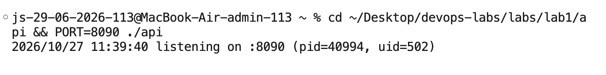Проверяем его здоровье, владельца и изоляцию (ее отсутствие):
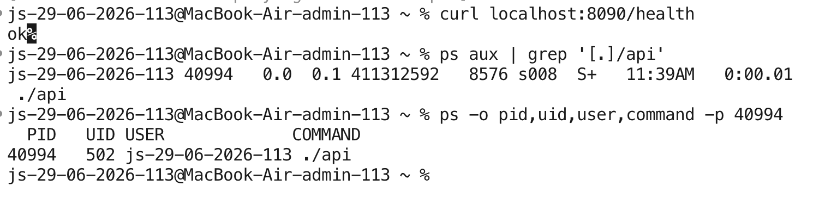

Ну, собственно - вот. Победная гифка.


## Часть 2 — namespaces
Теперь запустим простенькую линукс-машину и поставим на нее некоторые тулзы. Она будет нашим полигоном для испытаний и начнутся они с namespaces. Обратим внимание на работу --privileged. Этот флаг как раз и позволяет снять все ограничения и дать все capabilities, чтобы мы, как опытные смешарики, шаманили с этим контейнером сами.
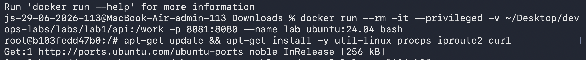

Запустим команду unshare с рядом параметров. Сие чудо создаст некий namespace, который ограничивает каждым флагом некие доступы к ресурсам. Клодик подготовил табличку и сказал заполнить. Я делать.

| namespace | флаг unshare           | что изолирует                                                                                                                                |
| --------- | ------------------------ | -------------------------------------------------------------------------------------------------------------------------------------------- |
| PID       | --pid                  | Он по сути изолирует  процессы и они теперь внутри namespace имеют свою нумерацию нежели внутри docker-контейнера.                           |
| Mount     | --mount                | Добавляет свои точки монтирования.                                                                                                           |
| UTS       | --uts                  | Изолирует название хоста, внутри namespace можно не палить имя хоста.                                                                        |
| IPC       | --ipc                  | У ядра свой список IPC-объектов (очереди, общая память), и без --ipc любой процесс мог бы к ним обратиться. А так не может!                  |
| Network   | --net                  | свой набор интерфейсов и маршрутов, изолированный соответственно.                                                                            |
| User      | --user --map-root-user | изолирует таблицу соответствия uid/gid, то бишь юзер внутри namespace может быть root, а на уровне выше - уже непривилегированный абсолютно. |
Есть еще пару неупомянутых, но использованных флагов - к ним относятся --fork - с ним новый PID namespace получает только потомок процесса, а не сам unshare. На самом деле ооочень долго пытался понять как это работает, ну благо у меня был терпеливый собеседник. Ну и --mount-proc, как можно понять, заново монтирует /proc.


Выполнил команду, и заодно попросил Клодика собрать скрипт для демонстрации работы флага --pid потому что не сразу понял как оно работает.  Наглядно вышло. 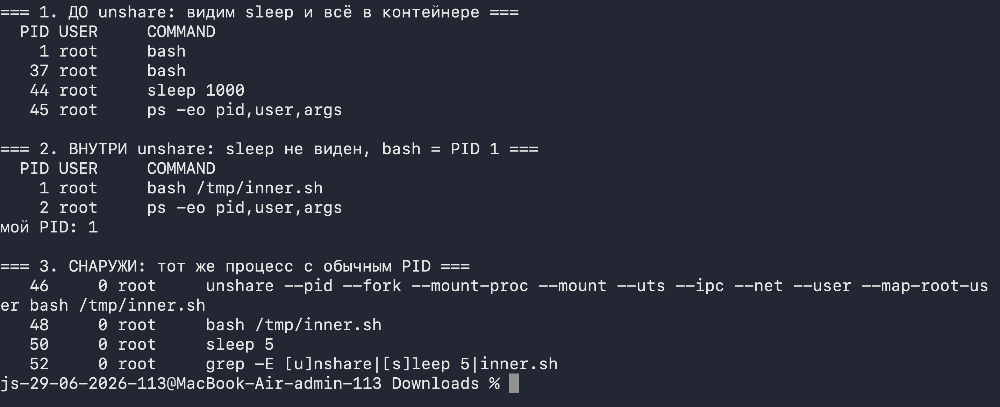

В следующем блоке мы подняли loopback (это у нас виртуальный сетевой интерфейс, который отправляет данные не наружу а внутри машины). До тех пор пок он не поднят - мы не можем локально подключиться к машине (самой себе), т.к. подключение идет на этот интерфейс и обрывается. С помощью ip link set lo up мы его включили. Однако, нужно настроить подключение и наружу - в наш любимый интернетик - для этого lo очевидно недостаточно - нужен интерфейс который будет смотреть наружу.

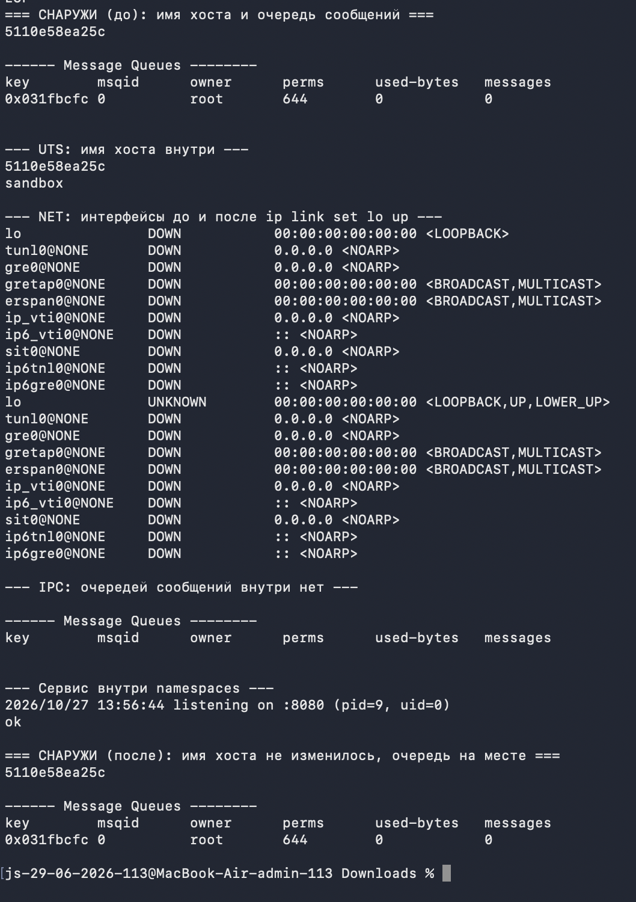
 Можно конечно долго изучать ограничивает ли ресурсы команда, которая должна ограничивать ресурсы, но не вижу смысла тут надолго задерживаться, основная идея была прочувствована всеми читателями.

В этой же части нам надо сделать пользователя обычным в ВМ и рутом в namespace. До этого момента он был и там и там рутом, возьмем нового в качестве подопытной лягухи.

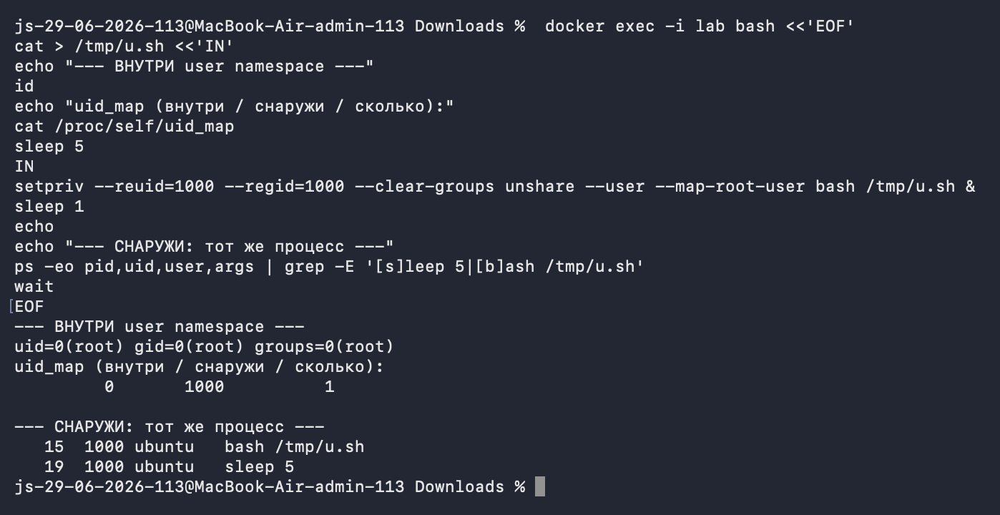

## Часть 3 — cgroups
Начнем эту часть с того что наконец кинем бинарник нашего сервиса в контейнер и посмотрим что там у нас с cgroups.
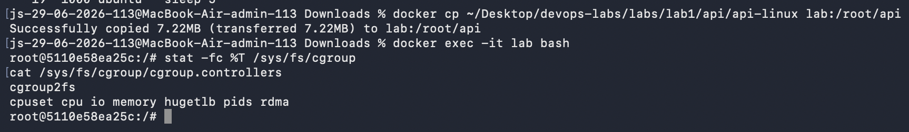

Т.к. в v2 нельзя включить контролееры в родительской cgroup пока в ней сидят процессы, переселяем процессы в init и создадим наконец лимиты. Ну и делаем это все в отдельной cgroup.
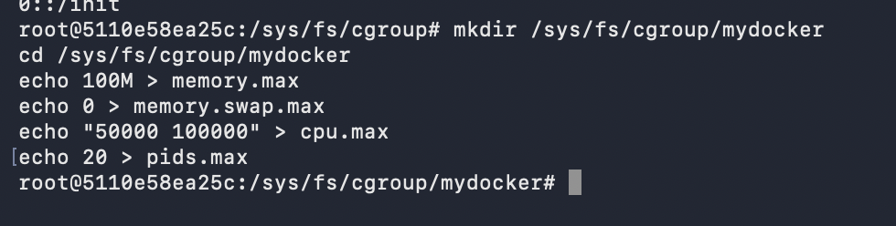
Лимиты создались, теперь возьмем процесс и посадим его в cgroups нашу. Memory.max будет ограничивать доступную память нашеGo процесса. Немного tricky оказался swap, без выключения которого лишнее вытеснится именно в swap и OOM нам не видать как джуну приглашений на собесы.
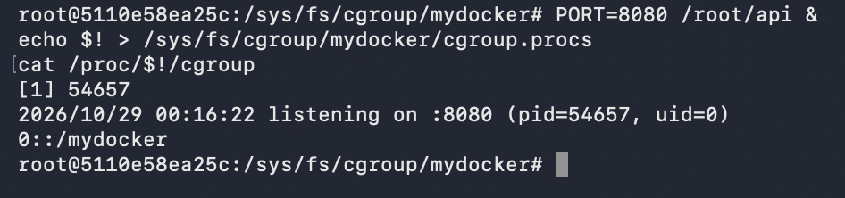
В целом, процесс запущен - попробуем дернуть eat и словить OOM. Поздравить себя с первым запланированным OOM что-ли?
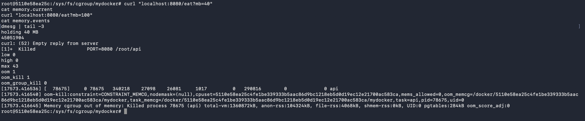

Троттлинг тоже прошел гладко. До первого скрина я еще раз запускал поэтому данные ненулевые. Можем наглядно увидеть что все три метрики подросли. Без лимита сервис съел бы все ядро, а так только половину.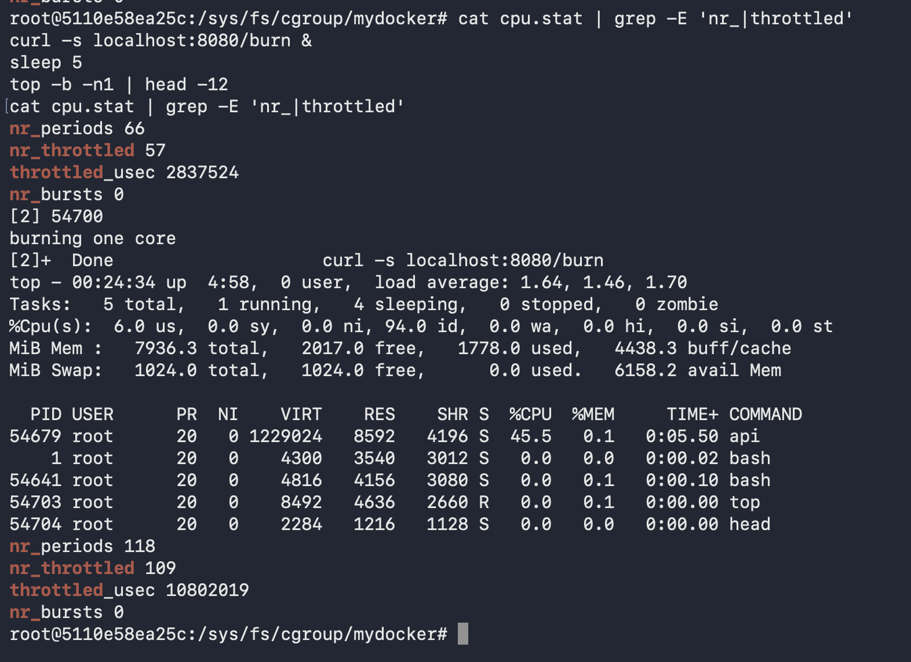

Последняя часть этого блока - имитация форк-бомбы. В начале блока с cgroups я поставил ограничений в 20 для pids.max. Тут-то мы и проверим работают ли они как должны, и ограничят ли форкование или нет.
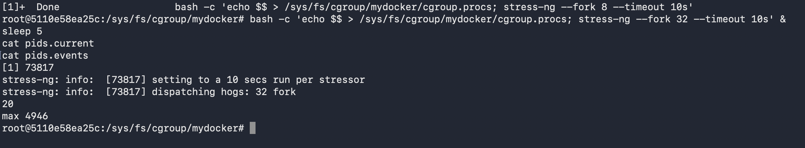
Как мы видим, наша система может спать спокойно, pids.current в процессе уперся именно в 20, и почти 5000 раз сработал лимит.

Грабля: с первого раза счетчик pids.events показал max 0, то есть лимит вроде бы ни разу не сработал. Я запустил форк-бомбу с --fork 8, а это слишком мало, чтобы упереться в 20. С --fork 32 все сработало.
## Часть 4 — Права

Capabilities - это у нас ограничения полномочий процесса внутри ядра.

Начнем с того что поделимся с читателями временем в которое мы занимаемся лабами.
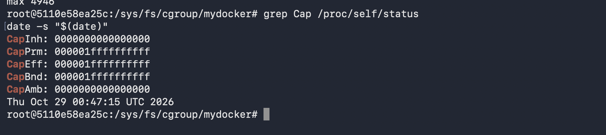

С помощью флагов из setpriv уберем все capabilities из bounding set'а, так еще и запретим их заново получить с флагом -no-new-privs. На попытку изменения времени получим соответствующую ошибку.
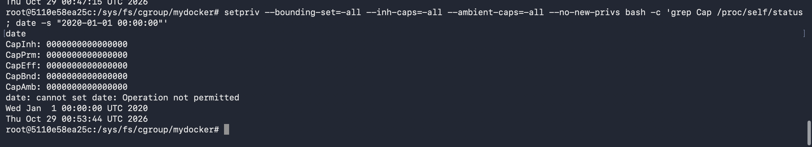

К слову о выводе, кто такие эти ваши Cap'ы и о чем они говорят?
CapInh - уровень привелегий для дочерних процессов
CapPrm -  самые максимальные привелегии которые процесс сам себе может дать
CapEff - текущее состояние привелегий
CapBnd - по сути что процесс в целом может получить
CapAmb - те привелегии что сохраняются при переходе между root-юзерами

Seccomp - ограничение уникальных вызовов системы.

Для иллюстрации обрисуем некий sandbox.c файл, который и будет ставить фильтр. Сам профиль лежит в json-файле и вызывается внутри. В нем запрещен вызов mkdir. 
```json
{
  "defaultAction": "SCMP_ACT_ALLOW",
  "syscalls": [
    {
      "names": ["mkdir", "mkdirat"],
      "action": "SCMP_ACT_ERRNO",
      "errnoRet": 1
    }
  ]
}
```

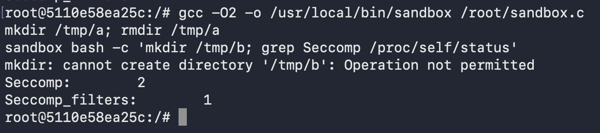Ка мы видим, операция не прошла, а значит seccomp работает.

Разница между этими двумя до боли простая - seccomp ограничивает набор системных вызовов процесса, а capabilities по сути описывают то, какие рутовские вызовы разрешены процессу.

## Часть 5 — Свой Docker
Пора собрать все, что мы натворили в предыдущих частях в один скрипт mydocker.sh. Он делает все то что мы делали руками: включает контроллеры и создает cgroup с лимитами, сажает в нее сам себя, а потом через setpriv опускается до непривилегированного uid 1000, создает namespace'ы через unshare, поднимает lo, ставит имя хоста sandbox, сбрасывает все capabilities и запускает sandbox , который уже делает exec нашего сервиса.

```bash
#!/usr/bin/env bash
set -euo pipefail

NAME="${NAME:-mydocker}"
MEM="${MEM:-100M}"
CPU_MAX="${CPU_MAX:-50000 100000}"
PIDS_MAX="${PIDS_MAX:-20}"
RUN_AS="${RUN_AS:-1000}"
CG="/sys/fs/cgroup/$NAME"

if [ "$#" -lt 1 ]; then
    echo "usage: $0 command [args...]" >&2
    exit 2
fi

if ! grep -q memory /sys/fs/cgroup/cgroup.subtree_control; then
    mkdir -p /sys/fs/cgroup/init
    for p in $(cat /sys/fs/cgroup/cgroup.procs); do
        echo "$p" > /sys/fs/cgroup/init/cgroup.procs 2>/dev/null || true
    done
    echo "+cpu +memory +pids" > /sys/fs/cgroup/cgroup.subtree_control
fi

mkdir -p "$CG"
echo "$MEM" > "$CG/memory.max"
echo 0 > "$CG/memory.swap.max"
echo "$CPU_MAX" > "$CG/cpu.max"
echo "$PIDS_MAX" > "$CG/pids.max"

echo $$ > "$CG/cgroup.procs"

exec setpriv --reuid="$RUN_AS" --regid="$RUN_AS" --clear-groups \
    unshare --user --map-root-user --pid --fork --mount-proc --mount --uts --ipc --net \
    bash -c 'hostname sandbox
ip link set lo up
exec setpriv --bounding-set=-all --inh-caps=-all --ambient-caps=-all --no-new-privs /usr/local/bin/sandbox "$@"' _ "$@"
```
Скрипт при первом запуске должен перенести все процессы в cgroup init, иначе echo +memory в subtree_control вернет ошибку, поэтому в начале стоит проверка grep по subtree_control, чтобы второй запуск не делал это заново. Собственно, я сначала столкнулся с этой ошибкой, потом только вспомнил об этой особенности. Еще у меня остались зомби- процессы  от stress-ng, там я тоже не догонял почему скрипт не стартует.

Запускаем. Сервис в фоне, лог в файл, а все проверки делаем снаружи по PID процесса:
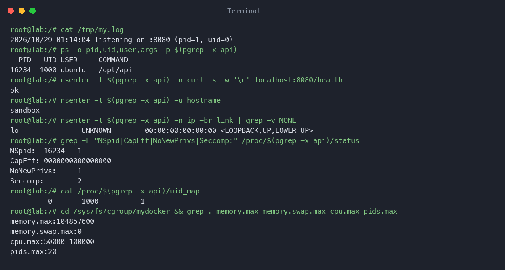
Что тут видно: ps снаружи показывает, что процесс принадлежит uid 1000, а лог самого сервиса говорит pid=1, uid=0. /health отвечает ok, но только если зайти в сетевой namespace процесса через nsenter -n, снаружи до него не достучаться - в namespace только lo, ни eth0, ни veth нет. Остальные строки ip -br link (tunl0, gre0, sit0 и т.д.) - это встроенные устройства модулей ядра ВМ, они нас мало интересуют. CapEff ноль, NoNewPrivs 1, Seccomp 2 - то, что мы ставили в части 4. И лимиты cgroup на месте.

Заодно можно пощупать, что namespace'ы действительно свои - идентификаторы все шесть разные:
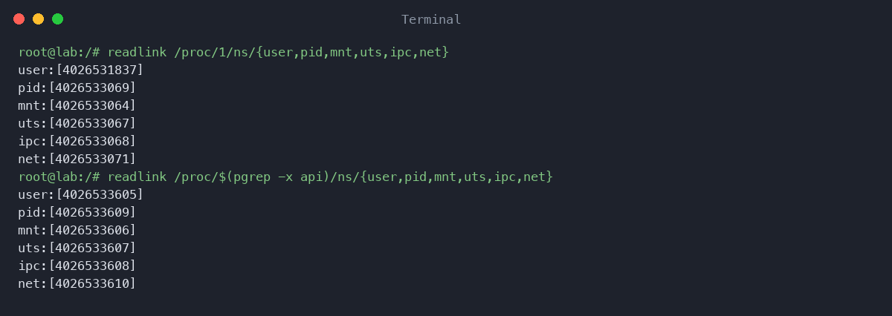

И проверим, что лимиты не просто лежат в файлах, а работают внутри скрипта. Просим /eat?mb=150 при потолке 100M:
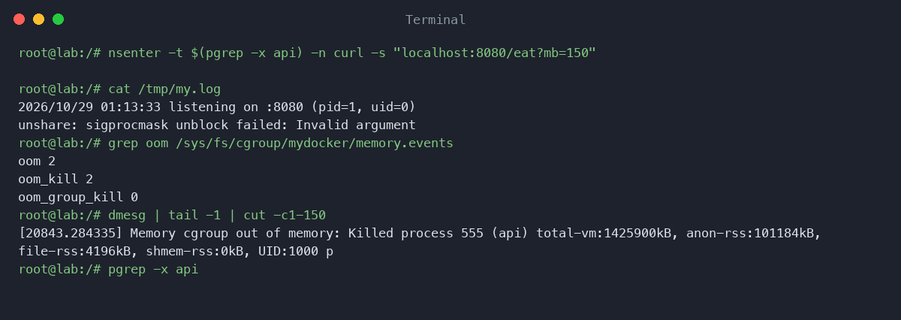
Сервис убит, oom_kill вырос, в dmesg строка про Memory cgroup. Второй в жизни запланированный OOM.
### Сравнение с docker run
Теперь тот же сервис через docker run. Сначала самый обычный запуск -глянем что докер навешивает сам:
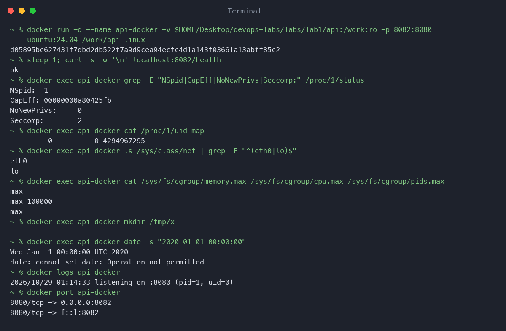
Из скрина:
- CapEff 00000000a80425fb - у докера по умолчанию остается 14 capabilities, а у нас вот ноль.
- Seccomp: 2 - Docker сам ставит свой seccomp-профиль, но заметим что NoNewPrivs там ноль.
- uid_map 0 0 4294967295 - user namespace у этого запуска по умолчанию нет вовсе и рут внутри и снаружи один и тот же. У нашего скрипта в вмке это просто юзер, а внутри - рут.
- memory.max и pids.max равны max, cpu.max - max 100000. Лимитов нет.
- eth0 есть, порт опубликован 8080/tcp -> 0.0.0.0:8082, а docker logs показывает вывод сервиса.
- mkdir проходит, а date -s все равно отклонен - CAP_SYS_TIME в стандартном наборе Docker нет.

А теперь выставим Docker те же флаги, что делает наш скрипт, и посмотрим, что совпадет:
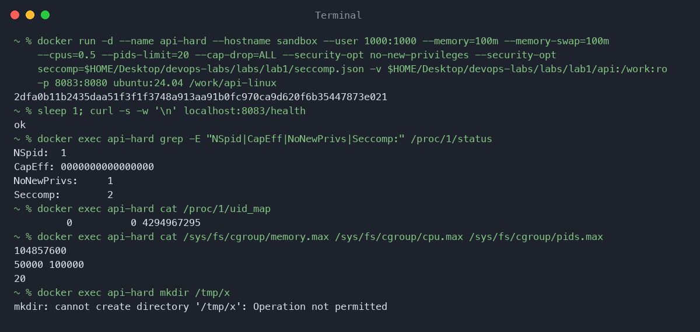
CapEff ноль, NoNewPrivs 1, Seccomp 2 с нашим seccomp.json, mkdir отклоняется, лимиты 100M / половина ядра / 20 процессов. Все аналогично.

То есть, подводя промежуточный итог, можно отметить что главное отличие нашего скрипта от докера это то, что у нас нет своей файловой системы и нормальной сети + томов/образов.
## Часть 6 — Образы
Нашему скрипту не хватало готовой файловой системы, и ее дает образ. Значит их надо сделать! Первый - простой, в лоб, на golang:1.23, в нем есть вообще все, включая компилятор:

```dockerfile
FROM golang:1.23
WORKDIR /app
COPY go.mod ./
COPY main.go ./
RUN go build -o /app/api .
EXPOSE 8080
CMD ["/app/api"]
```

Второй - multi-stage: собираем на golang:1.23, а в итоговый образ кладем только готовый бинарь поверх scratch (абсолютно пустой образ):

```dockerfile
FROM golang:1.23 AS build
WORKDIR /src
COPY go.mod ./
COPY main.go ./
RUN CGO_ENABLED=0 go build -ldflags="-s -w" -o /out/api .

FROM scratch
COPY --from=build /out/api /api
USER 1000:1000
EXPOSE 8080
ENTRYPOINT ["/api"]
```

CGO_ENABLED=0 нужен, чтобы бинарь не зависел от системной libc, которой в scratch просто нет. Еще сделал специально USER 1000:1000 чтобы мы не запускали от рута.

Собираем оба и сравниваем:
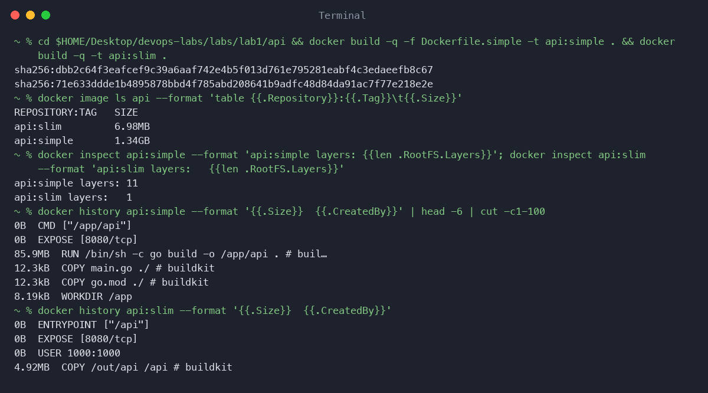


Заметим что simple образ оооочень большой и у него 11 слоев. Slim же в этом плане намного легковеснее. Теперь попробуем заставить сработать кеш - пересоберем образ, а затем изменим его и снова пересоберем.
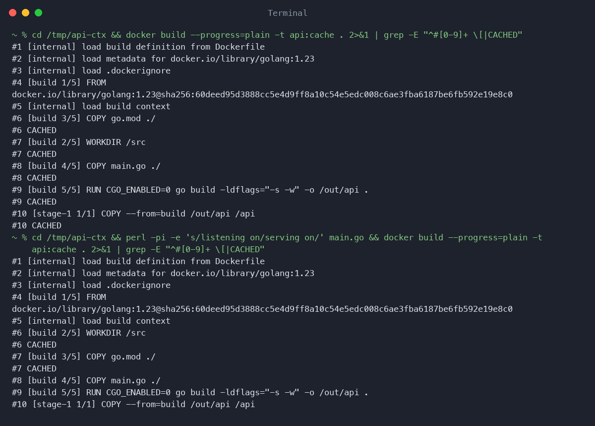
В первый раз все шаги CACHED, сборка мгновенная. После правки кеш остался только на некоторых шагах.

Теперь поработаем с данными внутри контейнера. Пишем файл внутрь контейнера, пересоздаем контейнер и смотрим:
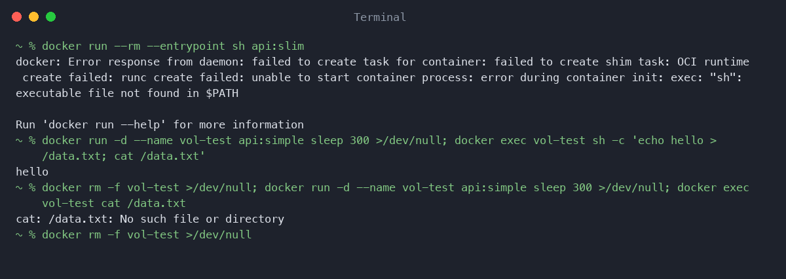
Файла нет. Контейнер - это тонкий слой записи поверх образа, и он удаляется вместе с контейнером. Для этого опыта пришлось взять api:simple ибо в scratch нет даже sh. 

Повторяем с именованным томом:
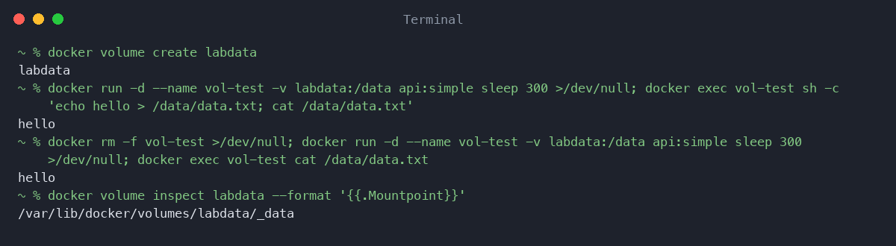
Файл пережил пересоздание контейнера. Том живет отдельно от контейнера и лежит в /var/lib/docker/volumes/..., причем внутри вм а не на устройстве.

## Часть 7 — gVisor
Поставить runsc как рантайм в докер не получилось, демон Docker Desktop живет в закрытой вм поэтому образ я запускал напрямую через runsc, по OCI-спецификации. Берем файловую систему образа через docker export, кладем в rootfs, генерируем config.json командой runsc spec и запускаем runsc run -bundle. Вся эта обвязка в скрипте gvrun.sh. 

Кстати с --network=host порт сервиса наружу не открылся, как выяснилост внутри gVisor свой сетевой стек и хостовой сети у него нет. Поэтому запускаю с --network=none.

Сначала сам образ api:slim под gVisor, и здоровье сервиса внутри песочницы (сеть отключена, поэтому /health проверяю через /dev/tcp):
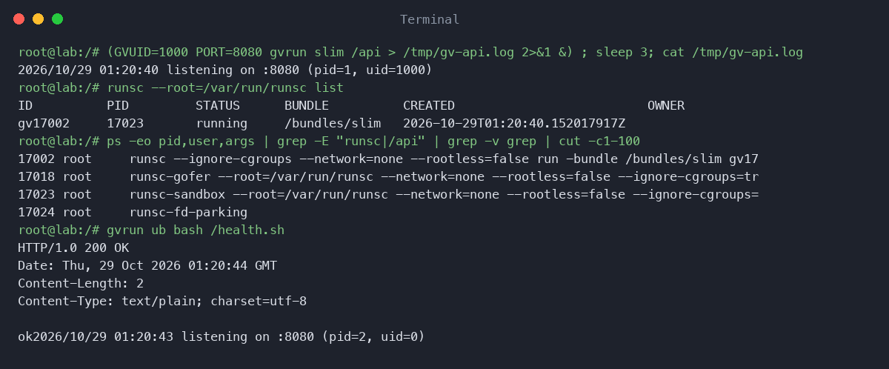
Сервис стартует как есть, с uid=1000 из образа. И интересная деталь: на хосте (в ps) приложения как процесса нет, есть только runsc, runsc-gofer, runsc-sandbox и runsc-fd-parking. 

Теперь сравним все три способа одним и тем же скриптом проверок, который милый клодик нам подготовил: версия ядра, dmesg, число записей в /proc, CapBnd/Seccomp, и две нагрузки - 300 тысяч итераций dd по одному байту (это порядка 600 тысяч системных вызовов) и чистый CPU-цикл на awk:
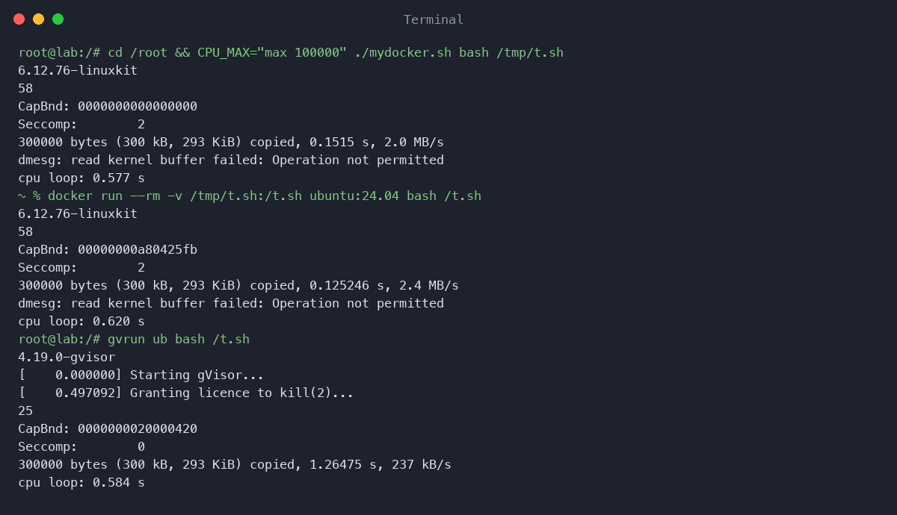

Что видно? Под mydocker.sh и обычным Docker ядро одно и то же, 6.12.76-linuxkit, и в /proc по 58 записей. Внутри gVisor uname показывает 4.19.0-gvisor: это не настоящее ядро, а то, что эмулирует Sentry (как я понял), и записей в /proc всего 25, потому что Sentry реализует только нужное. dmesg у наших скриптов отказывает (нет CAP_SYSLOG), а в gVisor работает, но печатает выдуманный лог, настоящий журнал ядра оттуда не достать. CapBnd: у mydocker.sh ноль, у Docker 00000000a80425fb, у gVisor 0000000020000420. Seccomp 2 у первых двух, а внутри gVisor 0: фильтр там не нужен, системные вызовы и так обрабатывает Sentry.

Цена такой изоляции в следующем - чистый CPU-цикл на awk везде одинаков (0.58, 0.62 и 0.58 с), потому что одни и те же инструкции исполняет один и тот же процессор. А 300 тысяч итераций dd по одному байту (порядка 600 тысяч системных вызовов) занимают 0.15 с у mydocker.sh, 0.125 с у Docker и 1.26 с в gVisor, то есть примерно в 10 раз дольше: каждый вызов теперь обрабатывает Sentry. Для честного сравнения CPU-цикла у mydocker.sh я отключил лимит в пол-ядра (CPU_MAX="max 100000"), иначе он удвоил бы время.

Поэтому gVisor и считают более изолированным: контейнер не может выполнить уязвимый код ядра хоста напрямую, наружу идет только узкий набор вызовов Sentry, а не все подряд.

И у mydocker.sh, и у обычного Docker каждый системный вызов выполняет то же ядро, что и у хоста. Namespace'ы, cgroups, capabilities и seccomp ограничивают, что процесс видит, сколько берет и какие вызовы делает, но не меняют того, что по ту сторону баррикад все равно сидит ядро. Значит, любая уязвимость в нем (привет весенний Copy Fail на линуксе), доступная через разрешенный системный вызов, ломает изоляцию сразу всем контейнерам на машине. 

## Часть 8 — Мониторинг
Стек в monitoring/compose.yml: api под лимитами из части 3 (100 МБ, 0.5 CPU, 50 pid), cAdvisor, Prometheus и Grafana с дашбордом, который подтягивается из provisioning. cAdvisor отдает метрики cgroup'ов контейнера, Prometheus их собирает, правила лежат в monitoring/alerts.yml.

Вот такой миленький дашборд у нас вышел: working set против memory.max, доля памяти от лимита, использование CPU против cpu.max, доля периодов с троттлингом и аптайм контейнера.

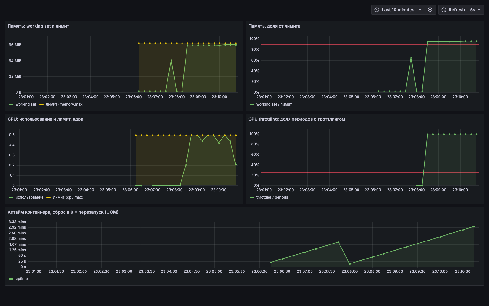

На графике видно три момента: короткий всплеск памяти до ~65 МБ (обычная нагрузка), потом упор в лимит 96–100 МБ, после которого аптайм сбросился в ноль, то есть OOM-kill и перезапуск по restart: unless-stopped. CPU уперся в потолок 0.5 ядра, и throttling встал на 100%: каждый период CFS контейнер выбирал квоту и ждал следующего.

### Три метрики под алерты
| метрика                                                                                                                 | что ловит                                       | чем грозит                                                    |
| ----------------------------------------------------------------------------------------------------------------------- | ----------------------------------------------- | ------------------------------------------------------------- |
| container_memory_working_set_bytes / container_spec_memory_limit_bytes > 0.9 (ContainerMemoryNearLimit)                 | память выше 90% лимита                          | ядро скоро убьет процесс по OOM                               |
| rate(container_cpu_cfs_throttled_periods_total) / rate(container_cpu_cfs_periods_total) > 0.25 (ContainerCPUThrottling) | сервис тротлится больше чем в четверти периодов | растут задержки, а загрузка CPU при этом выглядит «нормально» |
| changes(container_start_time_seconds[10m]) > 0 (ContainerRestarted)                                                     | контейнер перезапускался                        | OOM-kill или падение                                          |

Берем working_set, а не usage: в usage входит page cache, который ядро отдаст при нехватке памяти, а OOM срабатывает именно по working set.

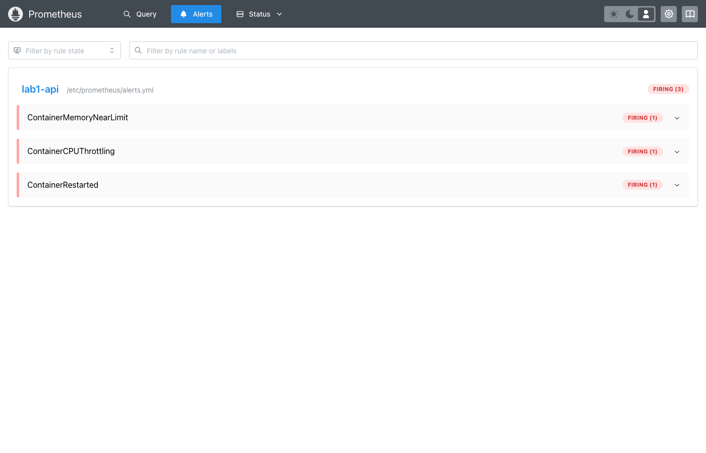

Все три сработали (FIRING), когда я упирался в лимиты нагрузкой.

Вот как-то так. Сие чудо заняло у меня полтора дня (намешанных с моей работой конечно) и я слабо понимаю как успеть сделать еще, но кто не пробует тот не получает стипендию 2400 и не пользуется БСК.
