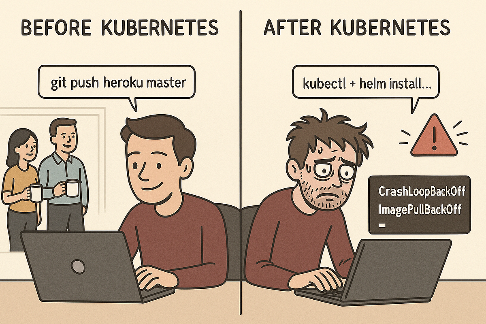
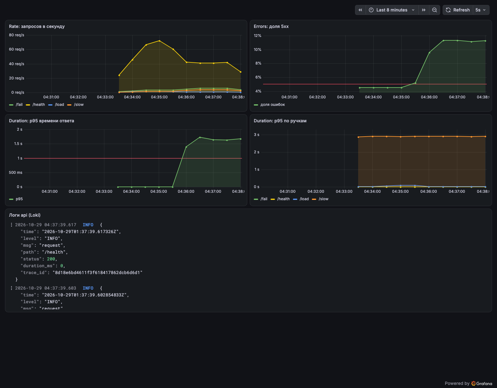
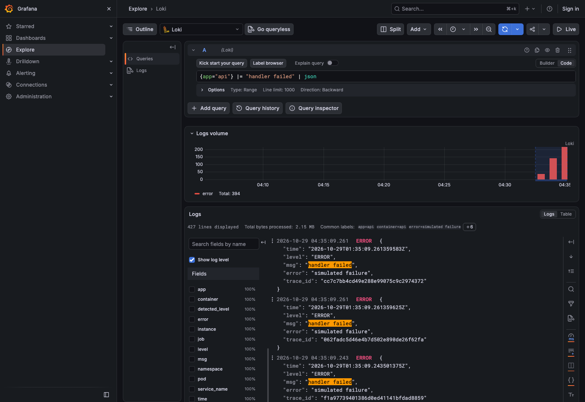
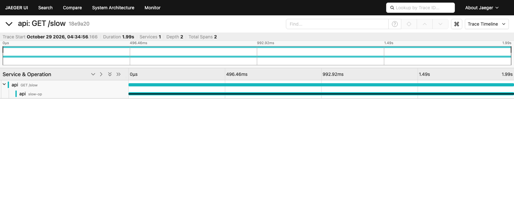
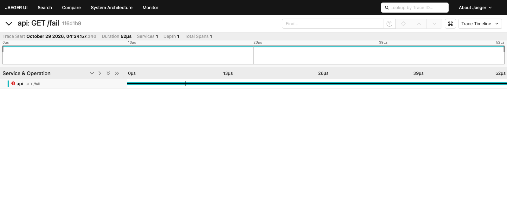
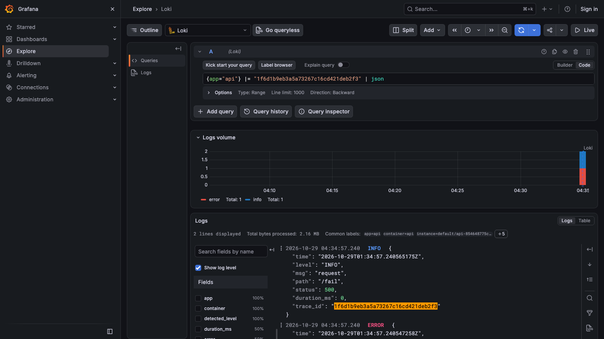
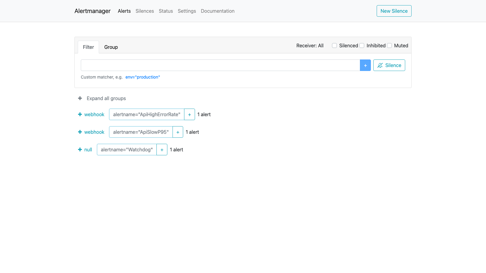
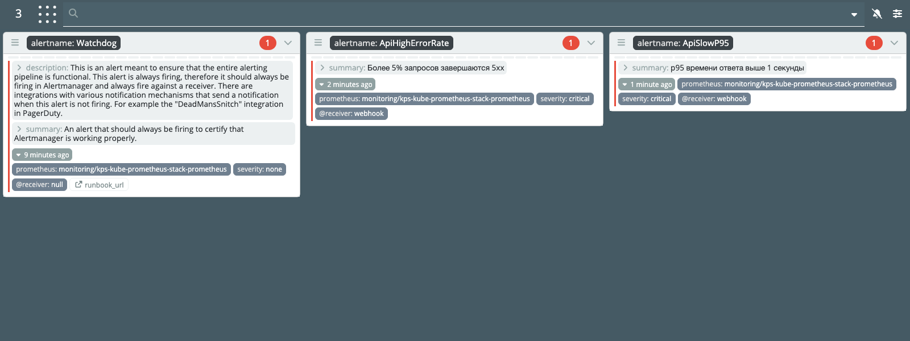
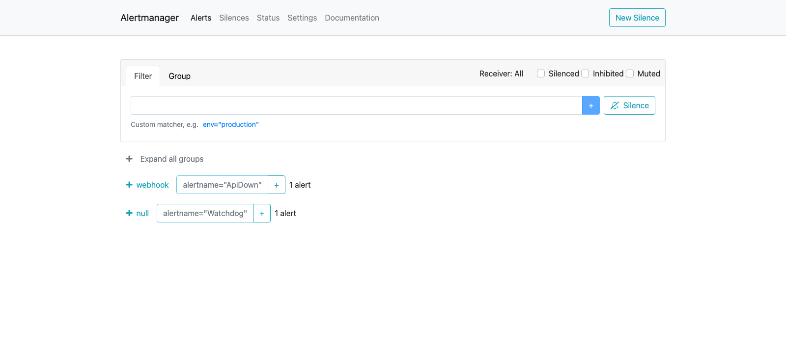
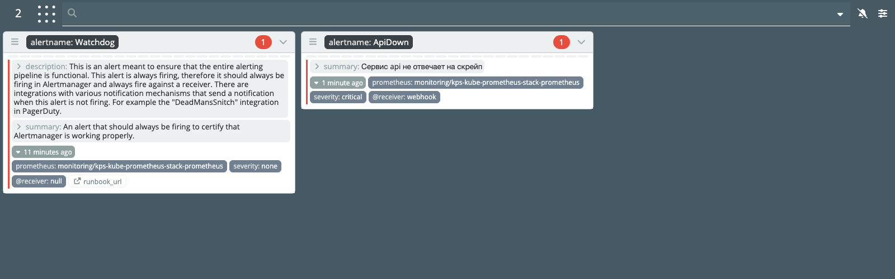

# Лаба 2 — Мониторинг сервиса: метрики, логи, трейсы

Вторая лаба, и тут уже кубернетес. Цель - поднять вокруг одного сервиса полный мониторинг: метрики, логи, трейсы и алерты. Все ставится через Helm, никакого docker compose.


## Часть 0 — Сервис и кубернетес
Сервис в этот раз новый. Он снова на Go, но теперь это не набор ручек для убийства контейнера, а игрушка для мониторинга. Пять ручек:

- /health - просто ok;
- /fail - отдает 500 и пишет ошибку;
- /slow - спит от одной до трех секунд;
- /load?n=40 - делает n запросов к самому себе, чтобы подскочил RPS;
- /metrics - метрики для прометеуса.

Внутри сервис считает запросы, ошибки и время ответа (гистограммой), пишет логи в JSON и в каждую строку кладет trace_id текущего запроса. Трейсы он отправляет сам через OpenTelemetry. Внутри /slow медленная операция завернута в отдельный вложенный спан, чтобы в водопаде было видно, куда ушло время, а /fail помечает спан как ошибочный. Dockerfile тот же, что в первой лабе: сборка в два этапа и пустой scratch.

Начал с того что свежие версии библиотек прометеуса и OpenTelemetry требуют Go 1.26, а я по привычке брал 1.23, и go mod tidy падал. 15 минут моего убитого ночного мозга были потрачены на эту мелочь. Ну это я так, пожаловаться...

Теперь кластер. Я взял kind: один control-plane и два воркера, в таком виде он съедает около 3.4 ГБ из 8 ГБ, выданных ВМ докера, так что больше нод ставить было страшно. В конфиге сразу проброшены порты под графану, прометеус и алертменеджер, чтобы открывать их с мака.



На моей машине kubectl по умолчанию смотрит в боевой кластер, а kind create cluster переключает контекст на себя. Чтобы не промахнуться и не пустить Helm куда не надо, я создал кластер с отдельным kubeconfig и все лабораторные команды гоняю только с ним. Основной конфиг остался нетронутым.

```bash
kind create cluster --name lab --config kind-config.yaml --kubeconfig ~/.kube/lab-kind
export KUBECONFIG=~/.kube/lab-kind
docker build -t api:2.0 api/
kind load docker-image api:2.0 --name lab
```

Образ в kind приходится загружать руками, иначе ноды не знают про локальный тег.

## Часть 1 — Метрики
Прометеус ставил готовым пакетом kube-prometheus-stack: в нем сразу прометеус, графана и алертменеджер. Все настройки лежат в values-файле, правил руками в интерфейсе нет. Сразу отключил скрейп etcd, scheduler, controller-manager и kube-proxy: в kind они снаружи недоступны, и без этого в прометеусе висел бы десяток вечно красных таргетов и лишних алертов.
Дашборд сделал по RED: сколько запросов, сколько из них ошибок и как быстро отвечаем. Добавил отдельную панель с p95 по каждой ручке, потому что общий p95 считается по всем запросам сразу, и /slow в нем тонет. 



Первый заход был недостаточно плохим - при нагрузке доля ошибок была 4.5%, то есть ниже порога в 5%, и алерт не горел. Пришлось усилить /fail, и тогда график вылез за красную линию. Заодно стало видно, что общий p95 остается на пяти миллисекундах, потому что /load плодит десятки быстрых запросов и топит редкие /slow. Зато по ручкам /slow отчетливо висит на трех секундах.
## Часть 2 — Логи
Локи - это только хранилище, сам он логи ниоткуда не забирает. Поэтому на каждую ноду нужен сборщик - я выбрал Grafana Alloy: Promtail уже уходит на покой, а мы хотим быть модными и молодежными. Локи поставил в режиме SingleBinary с файловым хранилищем, для лабы этого достаточно.
Локи подключен в графану как второй источник. Теперь метрики и логи в одном окне: на дашборд добавил панель с логами api. Дергаем /fail и находим ошибку:



## Часть 3 — Трейсы
Для трейсов взял Jaeger в режиме all-in-one. Чарт написал маленький - один деплоймент и сервис, OTLP принимается на порту 4318. Сервис находит его по переменной OTEL_EXPORTER_OTLP_ENDPOINT. Где-то здесь был достигнут Балмеровский пик.

Дергаем /slow и открываем трейс: корневой спан на три секунды и вложенный slow-op, который занимает почти все это время. То, ради чего трейсы и нужны: метрики сказали бы только что медленно, а водопад показывает где.



С /fail спан отмечен красным значком ошибки:



Самое приятное это связка логов с трейсами. В источнике локи в графане настроено поле derivedFields: оно вытаскивает trace_id из строки лога и делает из него ссылку на этот же трейс в Jaeger. Кликаешь по логу ошибки и попадаешь прямо в водопад - мечта программиста не иначе.



## Часть 4 — Алерты
Правила описал как PrometheusRule в том же чарте api, то есть алерты тоже лежат в коде. В качестве получателя поставил маленький приемник webhook-sink, который просто принимает запросы и пишет их в лог, по нему видно, что алерт дошел. Маршрутизацию тоже настроил в values. Навскидку взял три алерта, по которым на настоящем проекте пришлось бы реально вставать:
- ApiHighErrorRate. Доля 5xx больше 5% дольше минуты. Пользователи прямо сейчас получают ошибки. Дежурный смотрит логи по trace_id и откатывает последний релиз.
- ApiSlowP95. p95 времени ответа больше секунды дольше минуты. Сервис формально жив, но тормозит, и клиенты уходят по таймаутам. Дежурный ищет нужный шаг в водопаде Jaeger и проверяет зависимости и ресурсы.
- ApiDown. Нет ни одной живой цели. Сервис недоступен полностью. Проверить поды и события, перезапустить, эскалировать.

Чтобы алерты загорелись, я написал небольшой скрипт traffic.sh. Для p95 нужна своя нагрузка: шесть параллельных потоков на /slow, плюс /fail. Со смешанной нагрузкой из первой части p95 до секунды просто не дотягивал. После этого два алерта в состоянии firing:



Поверх алертменеджера поставил Карму. Для нее нет настройки nodePort в values, поэтому смотрю через port-forward. Карма опрашивает алертменеджер раз в минуту, так что сразу после срабатывания на скриншоте было два алерта из трех, третий пришел через минуту.



Потом проверил ApiDown: kubectl scale deploy/api --replicas=0. Забавно, что два остальных алерта при этом пропали сразу, а ApiDown загорелся примерно через минуту. Дело в том, что при пропаже метрик rate() становится пустым, и условия просто нечем проверять. Поэтому показать все три алерта одновременно нельзя, пришлось сделать два скриншота:





## Результат
Все собрано: сервис в кластере отдает метрики, прометеус их скрейпит, графана рисует RED и показывает логи из локи, в Jaeger виден медленный и ошибочный трейс, по trace_id лог ведет к трейсу, а три критичных алерта доходят до алертменеджера и видны в Карме.

Весь стек разворачивается одной командой stack/install.sh, сервис ставится через helm upgrade --install api charts/api, нагрузка создается скриптом traffic.sh.

Общие ощущения? Я работаю в компании, которая пишет быстро и дешево проекты, но так уж получилось что я сейчас на поддержании работы одного из таких проектов. Кубернетесом там не пахнет, но сделанная работа навела меня на определенные мысли по улучшению работы нашей графаны (которой до меня на проекте даже не было....), и фиксу алертинга. Я даже рассчитываю выбить на это немного часов у заказчика... А так, мониторинг это любовь с первого взгляда, мне всегда нравится смотреть всякие трейсики и дашбордики... Может надо было бизнес-аналитиком работать?
