# Лаба 3 — Платформа для shop

Третья лаба про то, как не дать никому задеплоить в кластер что попало, как поручить базу оператору и как узнать, что переживет падение control plane. Кластер тот же kind, что и во второй лабе, мониторинг оттуда же (kube-prometheus-stack, локи и Jaeger здесь не нужны, их не ставил).

## Часть 0 — Сервисы
Сервисов теперь два, оба на Go. api умеет:

- /health - ok, а при переменной HEALTH_FAIL=true отдает 503, она пригодится для сломанной версии;
- /version - какая версия образа сейчас отвечает, пригодится для rolling update;
- POST /order?item= - пишет заказ в postgres;
- /orders - отдает список заказов.

Worker раз в две секунды берет новые заказы и помечает их как done. Образы собраны в два этапа на scratch, как в прошлых лабах. Назвал я их registry.local/shop-api:1.0 и 1.1, registry.local/shop-worker:1.0. Имя с registry.local не случайное: в первой же политике я разрешаю только такой реестр. В kind образы попадают через kind load.

Сходу пришлось кстати поправлять сервис ибо  /health у api отвечал ok еще до подключения к базе, а /order в этот момент падал паникой с пустым ответом. На rolling update это ломало бы постоянно запуск. Пришлось сделать что пока нет соединения с БД, /health отдает 503, и все обработчики вместо паники возвращают 503.
## Часть 1 — Ограждения
Выбрал Kyverno, а не Gatekeeper. Правила тут это чистые манифесты и не нужен Rego. Gatekeeper мощнее, но не было желания разбираться с ним, времечко поджимало.

Все политики стоят в режиме Enforce. Системные неймспейсы я сразу исключил, иначе киверно заблокировал бы собственные поды. Сам Киверно поставил в минимальной конфигурации, только admission-контроллер, он умещается в один под. 

Правил шесть:
- require-resources. Без requests и limits один под может съесть ноду, а планировщик не сможет нормально разложить поды.
- trusted-registry. Только registry.local и образы CloudNativePG. Защита от чужих образов.
- require-labels. Обязательны метки app.kubernetes.io/name и team. По ним ищут владельца, строят селекторы и мониторинг.
- disallow-privileged. Привилегированный контейнер это почти root на ноде.
- disallow-latest-tag (мое). Тег latest не воспроизводим, откатываться некуда.
- require-nonroot (мое). Если процесс взломали, root внутри контейнера он не получит.

К каждой политике написал манифест-нарушитель в policies/violations, и каждый отклонен своей политикой. Седьмой манифест правильный и создается. Забавная мелочь: kubectl apply -f policies/\*.yaml падает с Unexpected args, потому что шелл раскрывает звездочку в кучу аргументов, надо -f policies/. Зато подпапка violations при этом не применяется, что удобно.

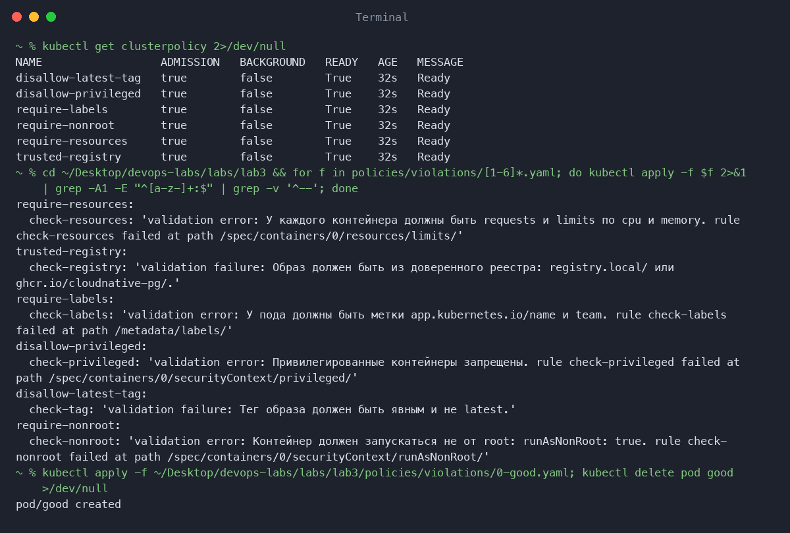

## Часть 2 — Чарт api и worker
Чарт charts/shop: api на три реплики, worker на две, пробы на /health, securityContext, resources и метки, то есть все, чего требуют политики. Тут меня ждал сюрприз, но в этот раз только приятный: с первого раза чарт встал. Чтобы все-таки увидеть отказ, подменил образ на nginx. helm upgrade упал с сообщением политики. Прикольно что Киверно сам превращает правила для подов в правила для Deployment, поэтому отказ приходит на создание деплоймента, а не на падающий под. Поды при этом остались от прошлой ревизии, но helm записал неудачную ревизию как failed.

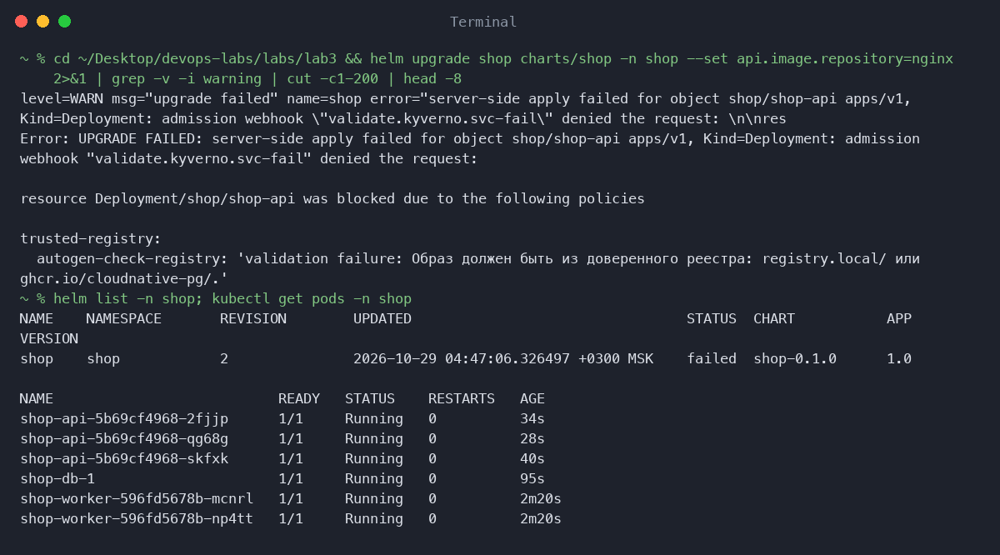

Reconciliation проверил двумя способами. Удалил под api, и он сразу вернулся. Поменял replicas в values, сделал helm upgrade, и число подов догнало новое значение.

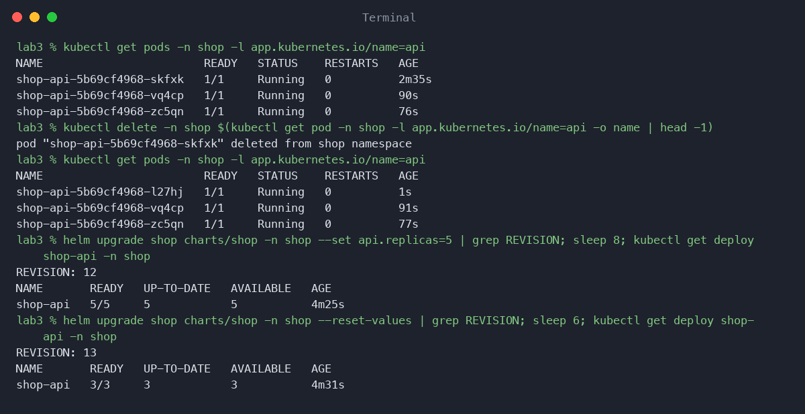

Тут я наступил на грабли Helm 4 ибо helm upgrade без флагов не сбрасывает значения от прошлого --set. Я вернул replicas в values.yaml на 3, а в кластере оставалось 5, пока не добавил --reset-values. 

Rolling update. Поднял тег с 1.0 до 1.1 и все время долбил NodePort на /version, всего 350 запросов. Скрипт probe.sh каждые 0.1 с считает коды ответа. Ни одного провала, версии идут вперед, поды обновляются по одному (maxUnavailable 0, maxSurge 1).

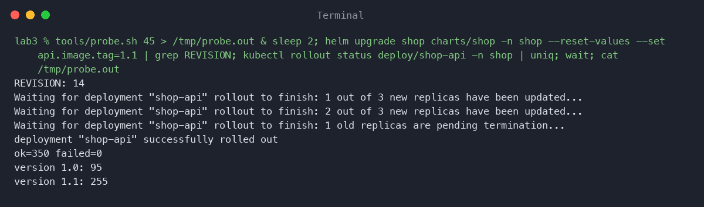

Сломанная версия. Выставил HEALTH_FAIL=true и сделал helm upgrade. Новый под не проходит readiness, потом уходит в рестарты по liveness, старые три остаются, rollout зависает по таймауту. При этом 585 запросов подряд прошли без ошибок: сервис ничего не заметил. helm rollback вернул кластер в рабочее состояние.

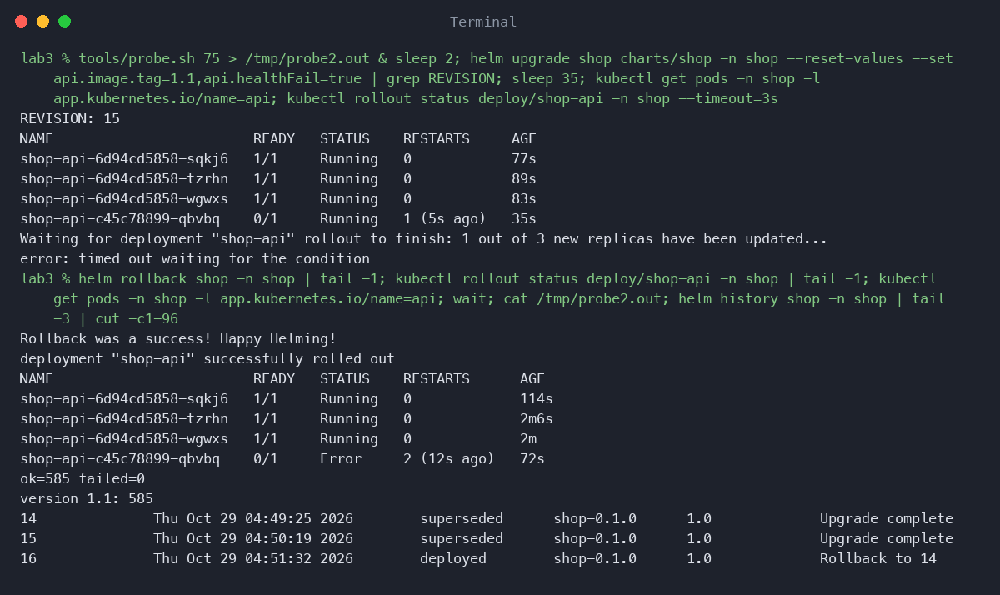

## Часть 3 — Postgres через оператора
Оператор CloudNativePG поставил один раз на кластер, а чарт просто создает объект Cluster. Удалил под shop-db-1 и тут же заметил странное: kubectl delete завис минут на три. Оказалось, оператор не убивает базу сразу, а делает плавное выключение и ждет, пока клиенты закроют соединения (smartShutdownTimeout 180 секунд). Потом оператор вернул под на тот же диск, заказы остались на месте.

В объекте Cluster есть spec и status. В spec лежит то, что я хочу (сколько инстансов, диск, ресурсы), в status то, что есть на самом деле (фаза, готовые инстансы, текущий primary) - тут я флешбекнулся на лекцию. На самом деле в такие моменты сильно ощущаешь разницу между теорией и практикой, слушал вроде понятно все было, а тут пришлось в целом на протяжении всей работы подзапариться.

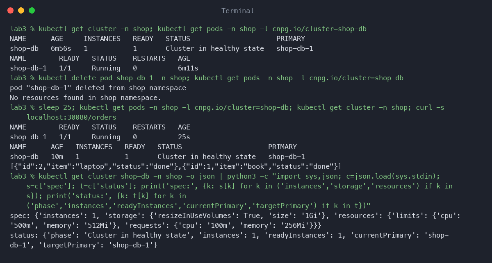

Принцип у них оператора и контроллер-менеджера общий: сравнить желаемое состояние с текущим и подтянуть. Но controller-manager это набор встроенных универсальных контроллеров (Deployment, ReplicaSet, Node), которые знают про поды и реплики. Оператор это свой контроллер для своего ресурса. Он знает предметную область: как поднять Postgres, выбрать primary ну и все в таком духе.

## Часть 4 — Падение control plane
Сначала хотел остановить apiserver через crictl stop, но в kind это статический под, и kubelet тут же поднимает его обратно. Надежно получилось только вынуть манифест kube-apiserver.yaml из /etc/kubernetes/manifests. После этого kubectl и helm падают сразу, даже apply не может скачать openapi. А вот shop работает как ни в чем не бывало: /health отвечает, заказ пишется в Postgres, worker его обрабатывает. Ну оно и логично пушто правила kube-proxy и контейнеры живут на нодах сами по себе и про apiserver не знают.

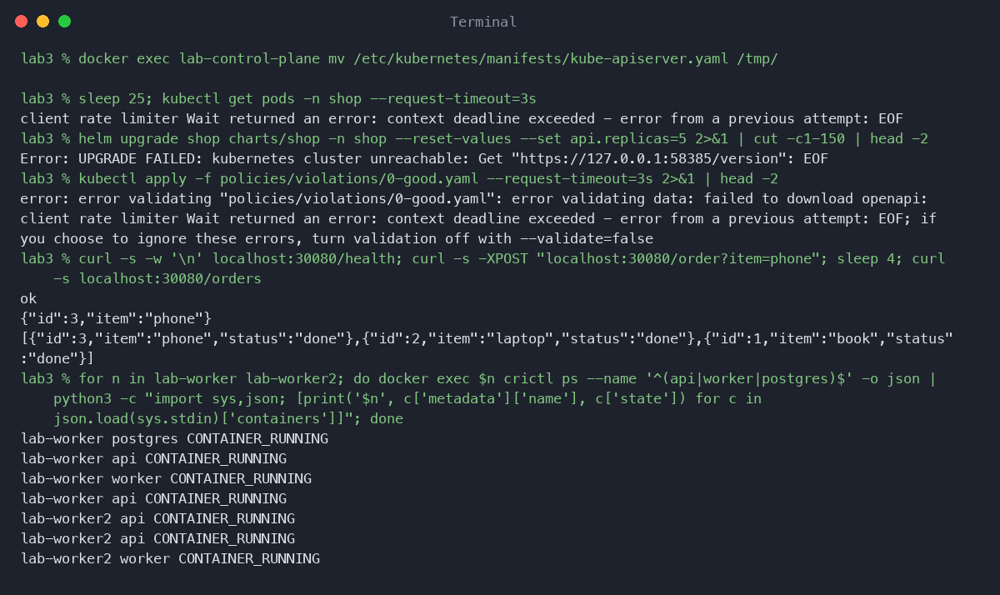

Вернул манифест, и узлы снова Ready.

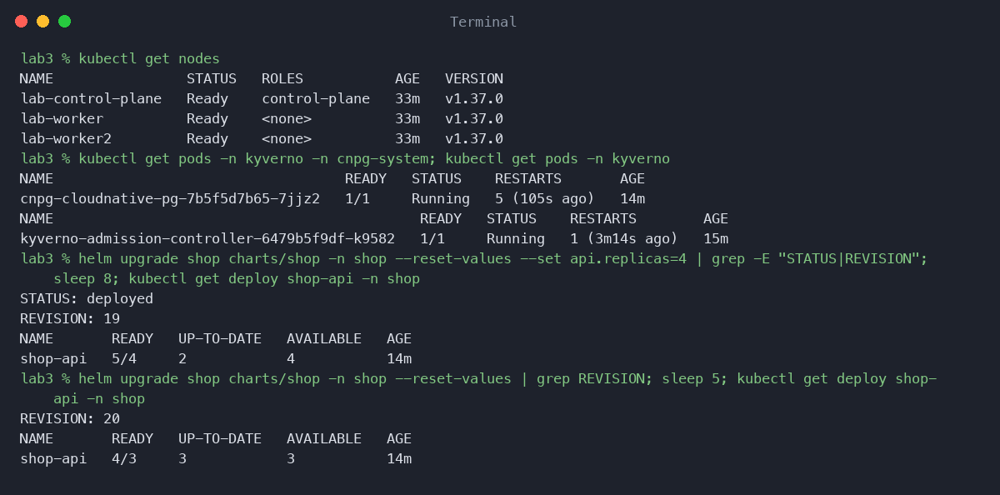

Самое интересное началось попозже ибо кластер стал управляемым не сразу. Оператор CloudNativePG ушел в CrashLoopBackOff, Киверно перезапустился. А у их webhook'ов failurePolicy Fail, поэтому пока они недоступны, любой helm upgrade падает с failed calling webhook. Пришлось ждать минуты три. Получается, что политики защищают кластер, но и сами становятся точкой отказа: упал apiserver, и после него восстановление блокируют собственные ограждения.

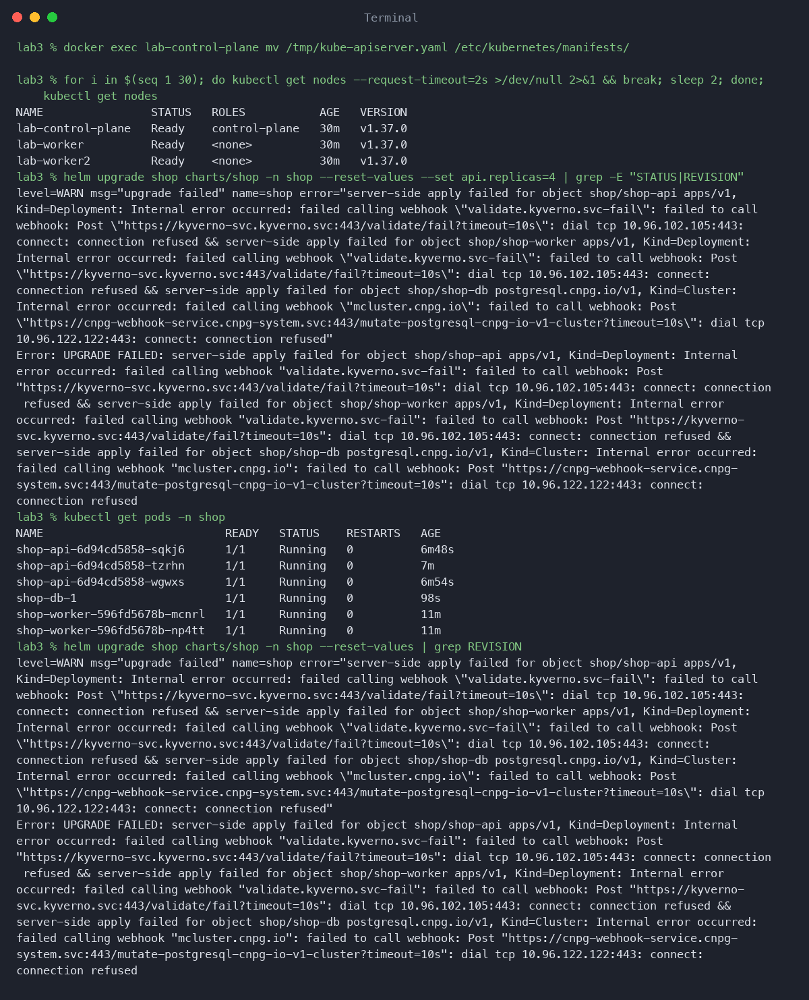

## Часть 5 — Мониторинг
Дашборд лежит в том же чарте, графана подхватывает его сама: реплики, запросы, очередь заказов и Postgres.

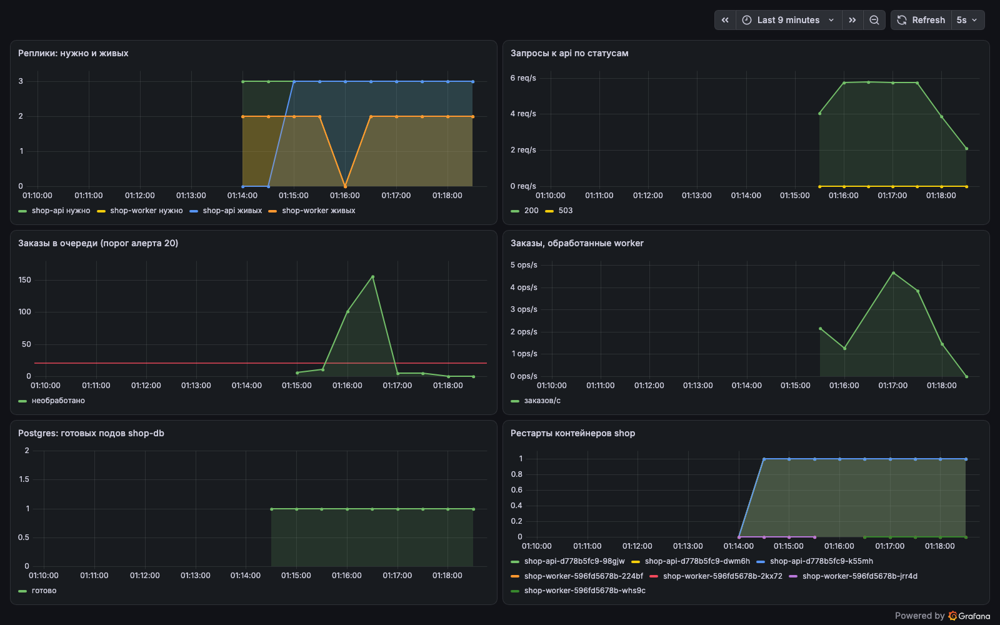

В чарт добавил ServiceMonitor для api и worker и PrometheusRule с тремя алертами, на стеке из лабы 2:

- ShopApiDegraded. Живых реплик api меньше двух дольше минуты. При трех репликах потеря двух это потеря запаса прочности, следующий сбой уронит сервис.
- ShopPostgresNotReady. Нет готового пода shop-db дольше минуты. Без базы не работают ни /order, ни /orders, ни worker.
- ShopOrdersBacklog. В базе больше 20 необработанных заказов дольше минуты. Сервис формально жив, но заказы не обрабатываются.

С третьим алертом было интересно - я считал очередь из worker'а, но когда worker убит (replicas 0), метрика пропадает целиком, выражение становится пустым, и алерт молчит. Перенес подсчет в api: он считает необработанные заказы в БД при каждом скрейпе, и теперь алерт от worker'а не зависит.

Спровоцировал два алерта: обнулил worker (заказы копятся) и оставил одну реплику api. Оба в состоянии firing. ShopPostgresNotReady я не провоцировал.

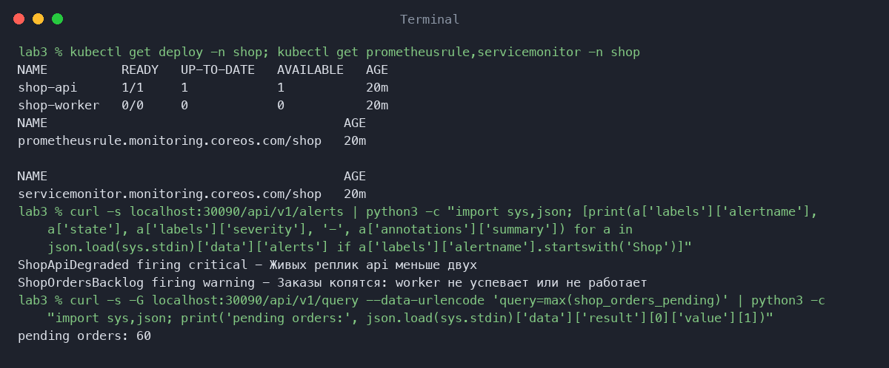

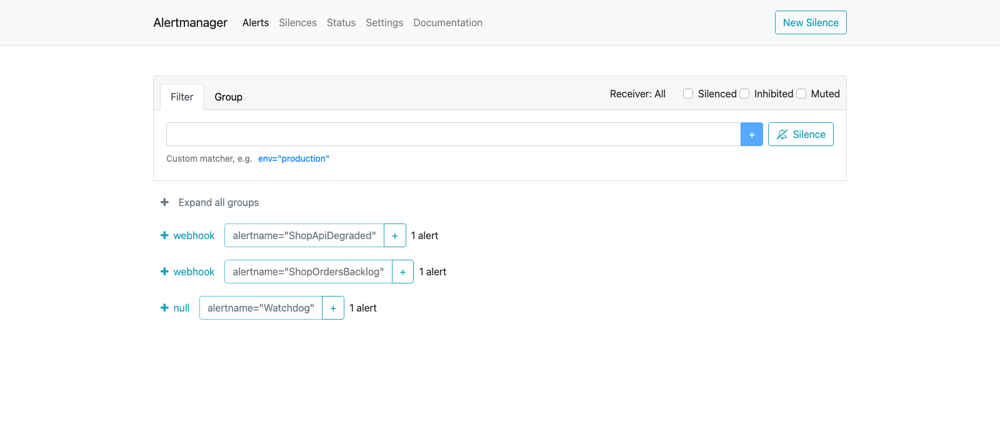
## Результат
В целом, сравнительно легче прошла эта лаба чем вторая, чуть-чуть втянулся. Мемы уже не вставляю потому что не смешно уже, невкусно и грустно. Сильно жалею что приходится читать второпях и делать второпях, ибо материал интересный, а я его хватаю только по вершкам + что-то уже знаю. Очень хочу найти время после закрытия предмета вернуться сюда поэтому плиз лягушачий сайт не закрывайте молю.