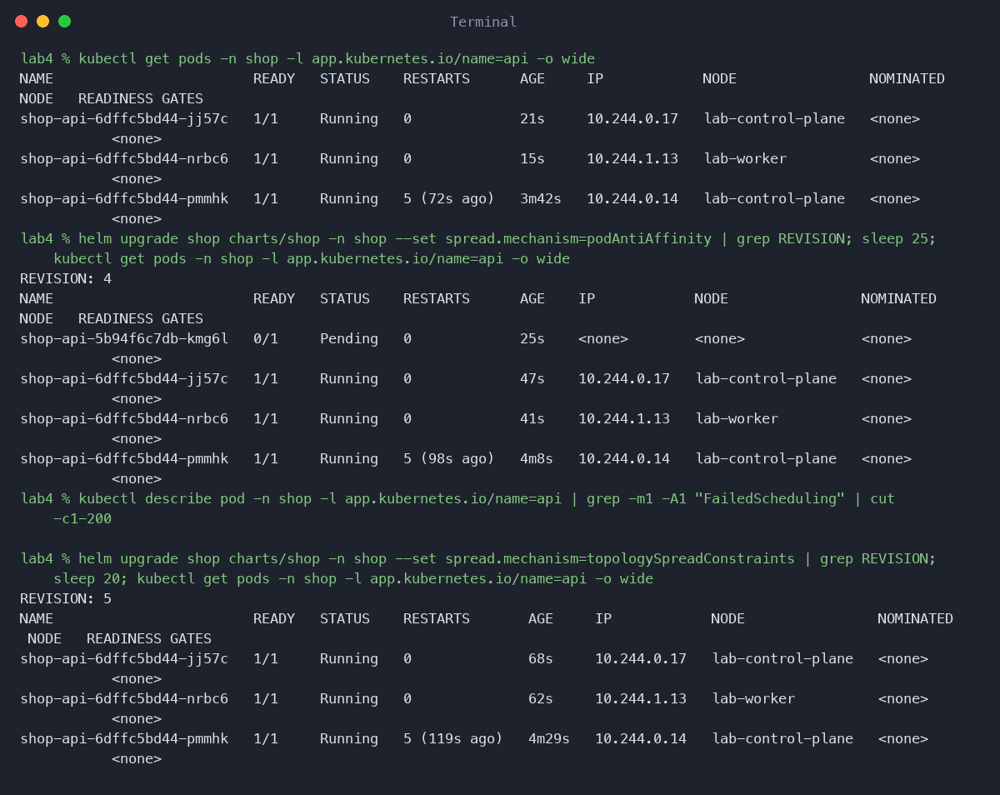
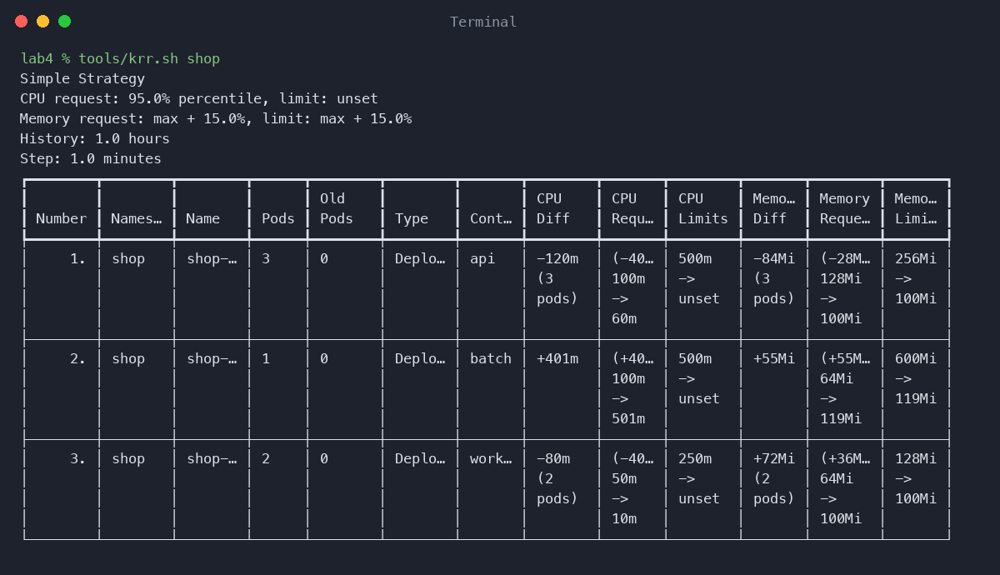
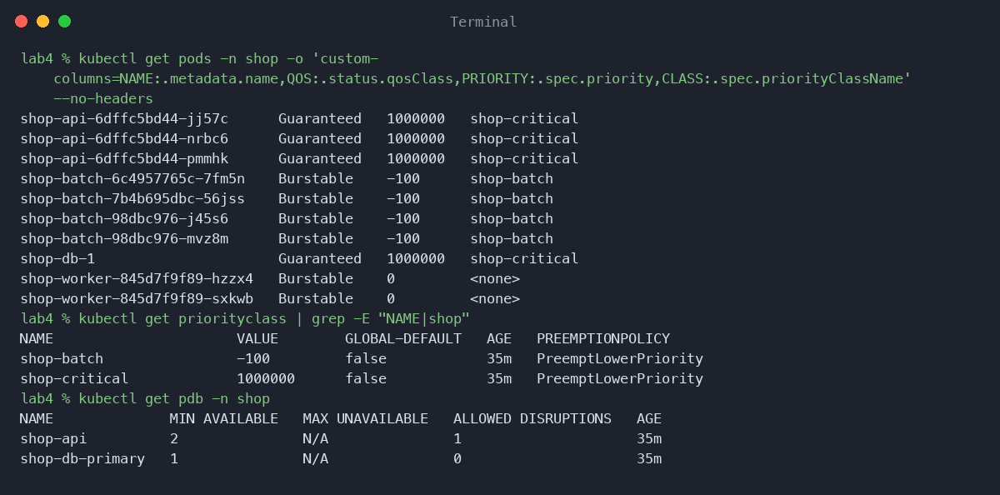
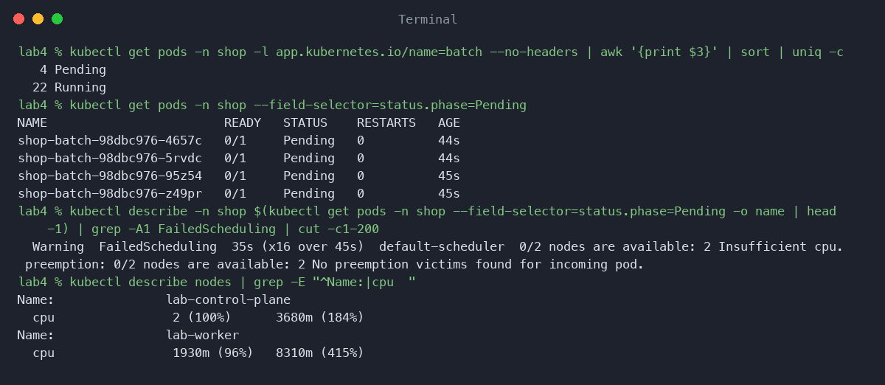
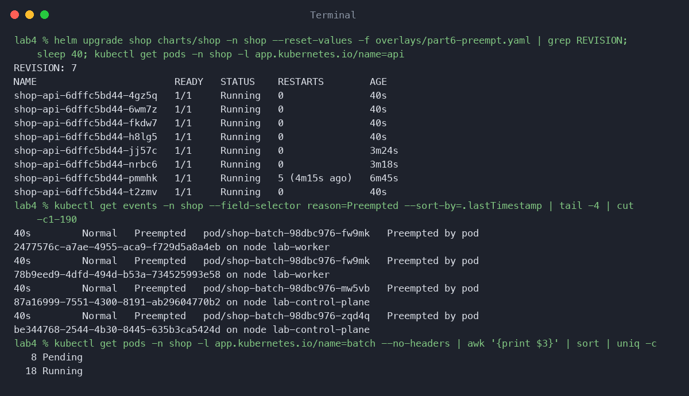
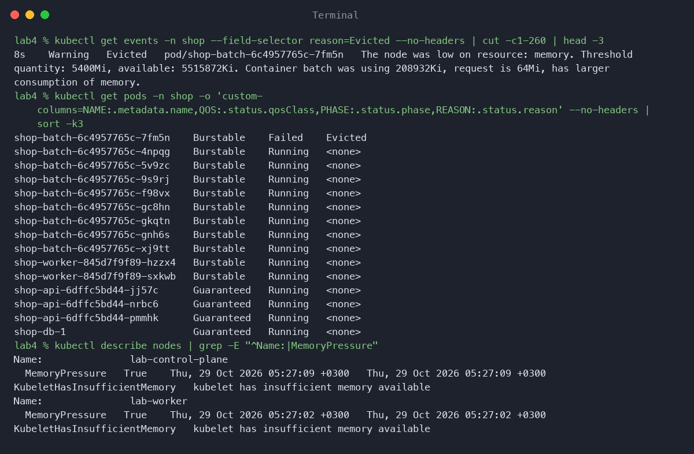
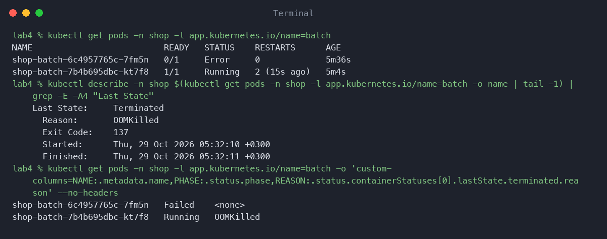
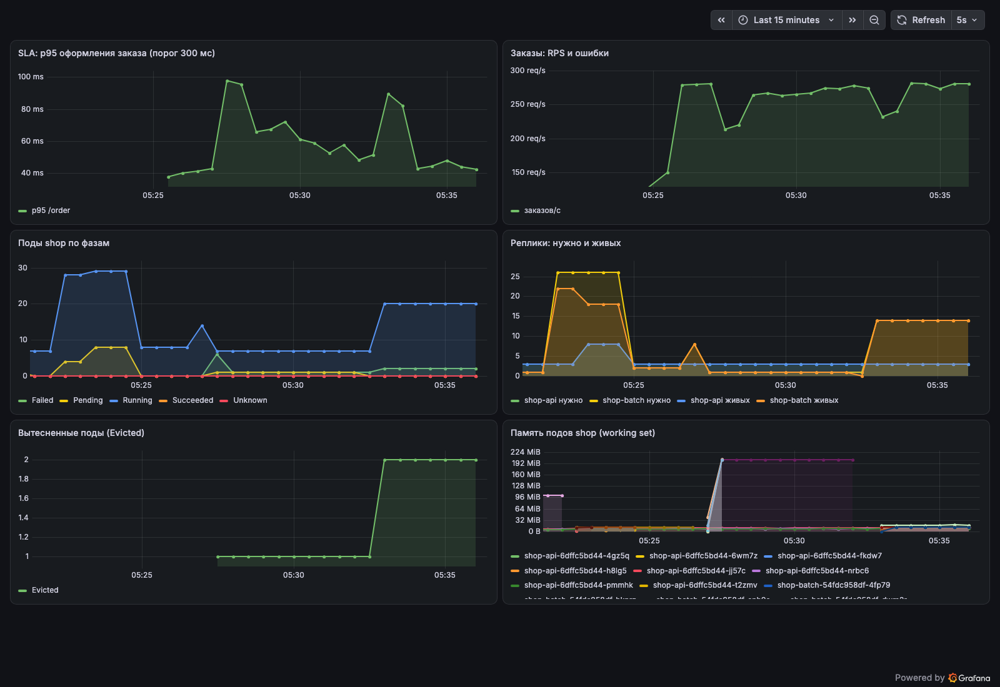
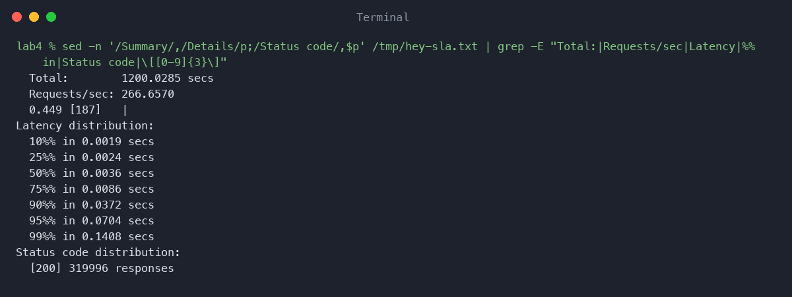
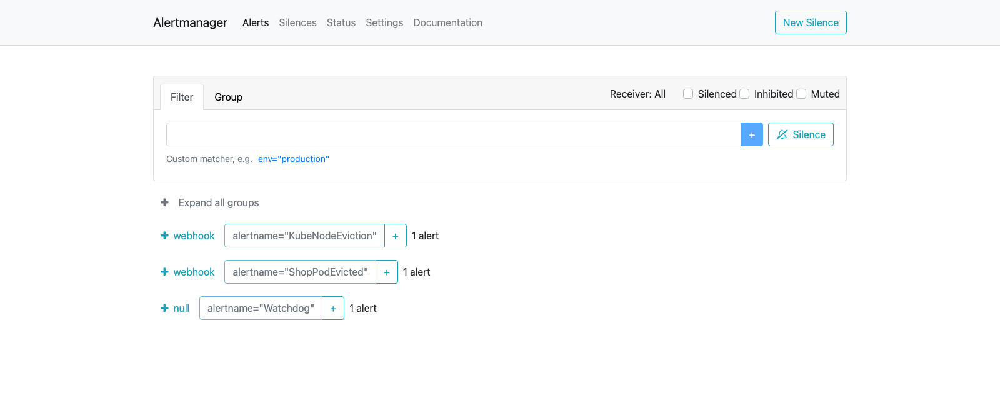

# Лаба 4 — SLA критического пути под перегрузкой

В этой лабе я специально делаю кластеру плохо: мало нод, не хватает процессора, не хватает памяти. Смотрю, кого кубернетес принесет в жертву, а кого защитит. Критический путь это заказ (api и postgres), а в жертву годится батч, заглушка для ночной аналитики. Все настройки лежат в чарте shop из лабы 3, а наблюдаю и провоцирую я уже руками. Мониторинг тот же kube-prometheus-stack, политики Киверно из лабы 3 действуют без исключений.

## Часть 0 — Сервис батч
Маленькая заглушка на Go. Выделяет BATCH_MEM_MB мегабайт памяти и держит их, плюс BATCH_CPU горутин крутятся в бесконечном цикле. Лимиты у нее есть, потому что политики из лабы 3 без них не пропустят. Просто приоритет у нее низкий, а requests маленькие.

## Часть 1 — Как разнести реплики
В values.yaml добавил параметр spread.mechanism, который переключает между podAntiAffinity и topologySpreadConstraints. Разница такая:

- podAntiAffinity жестко говорит не ставить под на одну ноду с таким же. Если реплик больше, чем нод, лишние остаются в Pending навсегда.
- topologySpreadConstraints просит равномерность с допустимым перекосом maxSkew. Три реплики на две ноды ляжут как 2 и 1, и сервис всегда запустится.

Выбрал spread ибо мне нужна равномерность, а не запрет. Запустил - с anti-affinity одна из трех реплик действительно повисла в Pending. Вернул spread, и реплики встали на обе ноды. Это же и доказательство для части 4: kubectl get pods -o wide показывает реплики api на разных нодах.

## Часть 2 — Тесная площадка
Кластер kind на две ноды: control-plane (с него снят taint, иначе api негде разносить) и один воркер. Тут узнал что в kind все ноды видят все 8 процессоров машины, и нехватку так просто не получить. Поэтому в кублет обеих нод прописал systemReserved cpu 6000m. Теперь allocatable на каждой ноде по 2 процессора, и дефицит настоящий.  Батч добавил новым шаблоном чарта, ставил через хелм апгрейд. Первые requests и limits для всех сервисов были моими догадками.
## Часть 3 — Реальные числа вместо угадывания
Гнал hey по POST /order около пяти минут, примерно 800 запросов в секунду, чтобы прометеус насобирал данные. Потом запустил krr через tools/krr.sh, он живет в контейнере и ходит в прометеус. У krr нашлись свои капризы: он отказывается работать с историей меньше часа и по умолчанию требует сто точек, а на свежем кластере столько нет. Стока времени у меня нет поэтому пришлось указать --points_required 3.

Что получилось по сравнению с моими догадками:

- api. Я предполагал 100m до 500m по CPU и 128Mi до 256Mi по памяти. krr предложил 60m и 100Mi. Взял это для requests и limits одновременно.
- worker. Догадка 50m до 250m и 64Mi до 128Mi. krr предложил 10m и 100Mi. Взял CPU 10m до 250m, память 100Mi.
- батч. Догадка 100m до 500m, 64Mi до 600Mi. krr предложил 501m и 119Mi: батч на деле съедает целое ядро, а я записал ему только 100m. Оставил как есть, об этом ниже.
- postgres. krr его не увидел вообще: под принадлежит ресурсу оператора, а не Deployment. Числа взял из прометеуса по тому же правилу, p95 CPU и максимум памяти плюс 15 процентов. Вышло 210m и 160Mi.

Расхождение понятно: api и worker оказались легче, чем я думал, потому что я прикидывал на всякий случай, да и батч я вообще нарочно занизил. Еще один нюанс: krr советует убрать CPU limit, но политики требуют limits, а для Guaranteed нужно requests равно limits. Поэтому limit CPU у меня равен request, и на пиках это значит троттлинг. Вообще клодик сказал что лучшей практикой считается не ставить CPU limits совсем, именно из-за троттлинга, но здесь их требуют политики и условие Guaranteed, так что я сознательно проигнорировал умного агента в очках скачать обои.

## Часть 4 — Разнос критического сервиса
Механизм из части 1 уже применен к api, доказательство на скриншоте выше. Это повышает отказоустойчивость очень просто: если упадет одна нода, не пропадут все реплики сразу, часть api продолжит отвечать.

## Часть 5 — Приоритеты, QoS и PDB
Теперь решаем, кого защищать, а кого не жалко:

- api и postgres. Requests равны limits, значит QoS Guaranteed. PriorityClass shop-critical на миллион. У api PDB с minAvailable 2, для postgres PDB делает сам CloudNativePG.
- батч. Requests сильно ниже limits, значит Burstable. PriorityClass shop-batch на минус сто.

Тут вышел нюанс. Я (и мой верный помощник Максимум Клодим Меридий ,сын Антропика) сначала написали свой PDB для postgres, а CloudNativePG, оказывается, сам создает такой по умолчанию. Выдал это встроенный алерт KubePdbNotEnoughHealthyPods, а kubectl get pdb показал два бюджета на один под. Eviction API такое не любит, так что свой убрал и оставил enablePDB в Cluster. Заодно увидел, что у одинокого postgres допустимых остановок ноль, и drain его ноды просто зависнет.

Что это дает под давлением? Приоритет решает, кого планировщик вытеснит ради места. QoS вместе с приоритетом решают, кого кублет выселит при нехватке памяти на ноде. Guaranteed уходит последним, а PDB не дает уронить api ниже двух реплик при drain или обновлении.
## Часть 6 — Pending и preemption
Сначала арифметика. После стека на control-plane свободно примерно 500m по requests, на воркере около 1670m. Выходит чуть больше двух ядер, и при 100m на под влезет штук двадцать два. Поднял батч до 26: двадцать два встали, четыре повисли в Pending с Insufficient cpu. Вытеснять некого, у всех батчей один приоритет, а планировщик считает по requests, а не по факту.

Потом поднял api с трех реплик до восьми. Планировщик выселил четыре батча (события Preempted), api стал 8 из 8. Выселенные поды Deployment тут же пересоздал, и они ушли в Pending, так что их стало восемь. В событии вместо имени пода лежит UID вытеснившего, сверял руками.

## Часть 7 — Давление по памяти
В kind кублет считает свободную память по ноде, и выходит около 6 ГиБ, хотя у ВМ докера реально свободно примерно 3. Дефолтный порог eviction недостижим, не убив ВМ целиком. Поэтому выставил evictionHard memory.available=5400Mi на обеих нодах и перезапустил kubelet. Поднял батч до восьми подов по 200Mi, ноды ушли в MemoryPressure, и кублет выселил батч (208Mi при request 64Mi). Api и postgres остались на месте, как и задумано.

Но заодно досталось графане, ее выселили три раза: у ее sidecar-контейнеров request равен нулю, так что они тоже кандидаты. Мониторинг падает ровно когда не надо. Еще ноды получили taint memory-pressure, и новые поды минут пять не планировались. Причину Evicted kubectl не показывает, видно только через custom-columns по status.reason.

OOMKilled показал вторым опытом: дал батчу выделить 800 МБ при лимите 600Mi, и ядро убило контейнер с кодом 137. Eviction это решение кублета, что ноде не хватает памяти, а OOMKilled это ядро убило процесс за превышение своего лимита. Симптом тот же, под пропал, а чинить в первом случае ноду и requests, во втором лимит пода.

## Часть 8 — SLA под нагрузкой
SLA такой: 95 процентов заказов быстрее 300 мс даже под перегрузкой. Чтобы мерить, добавил в api гистограмму времени ответа (в лабе 3 были одни счетчики) и собрал дашборд с p95 и долей ошибок. Потом запустил hey на двадцать минут (10 соединений, около 267 запросов в секунду, считает задержки и коды ответов) и параллельно проделал все из частей 6 и 7, плюс четырнадцать батчей, каждый из которых жжет по ядру. Нагрузка на ВМ дошла до 21 при 8 ядрах. Деградирует батч, критический путь держится.

Итог: 320 тысяч ответов, все 200, p95 70 мс, p99 141 мс, самый медленный 1.49 с. Находка по дороге: когда менял ресурсы у postgres, база перезапускалась, а liveness у api (тот же /health) убивала под, который не мог подключиться. Пять рестартов за три минуты. Liveness, зависящая от внешней базы, это антипаттерн.

## Часть 9 — Алерты
В чарт добавил ServiceMonitor и PrometheusRule с тремя алертами, исходя из того, что уже видел:

- ShopApiSlow. p95 запроса /order больше 300 мс дольше минуты. Это наш SLA, пользователь уже страдает.
- ShopPodsPending. Поды в Pending дольше минуты. Кластеру не хватает ресурсов, следующий деплой не встанет.
- ShopPodEvicted. Есть выселенные поды. Ноды под давлением по памяти.

Сработал ShopPodEvicted вместе со встроенным KubeNodeEviction, выселения я же устроил в части 7. Алерт липкий: выселенный под остается в API в фазе Failed, и горит он, пока его не удалить руками. Остальные два не провоцировал.

