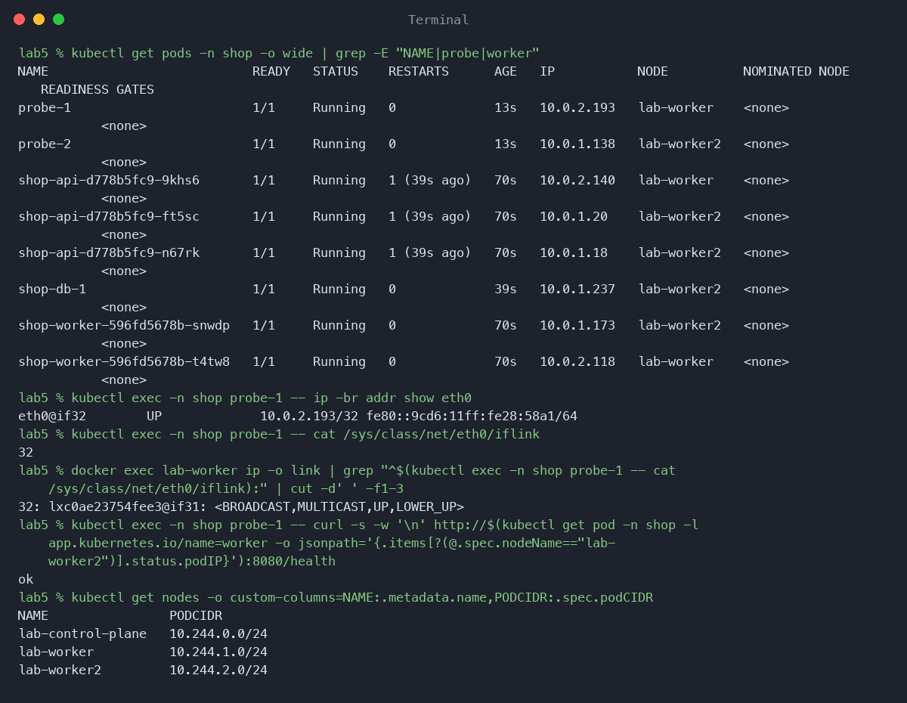
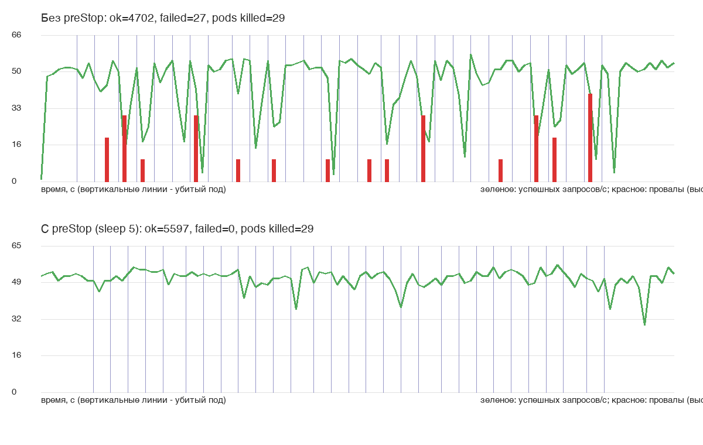
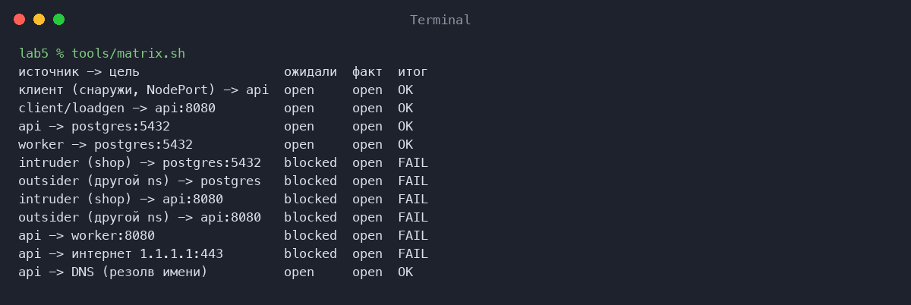
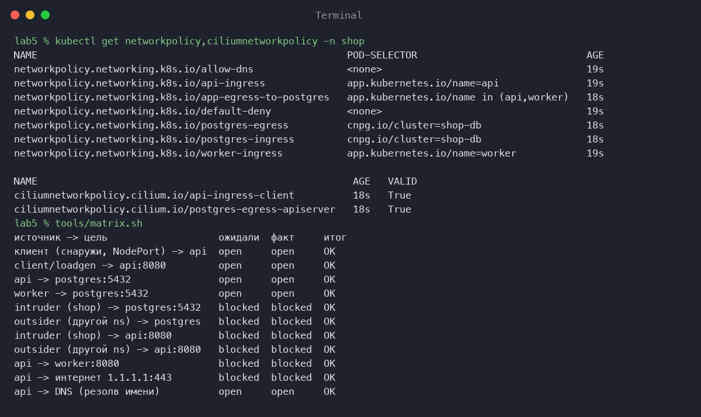
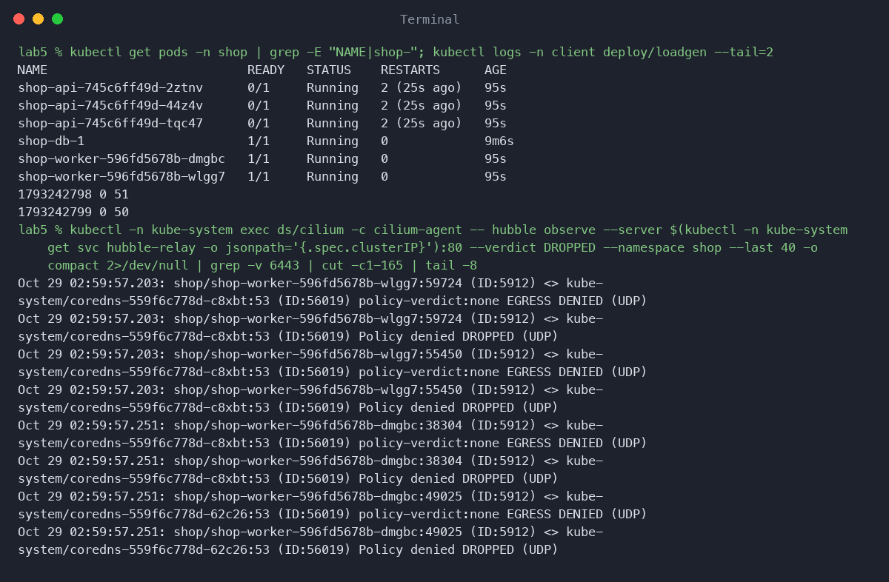
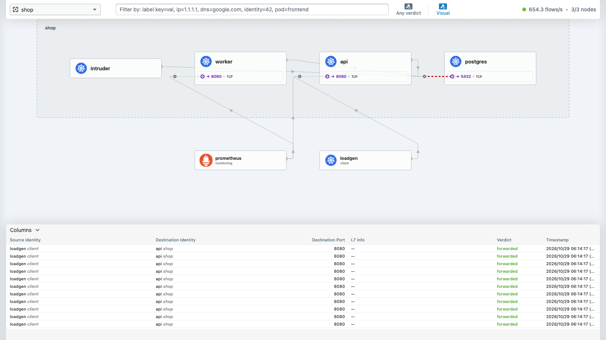
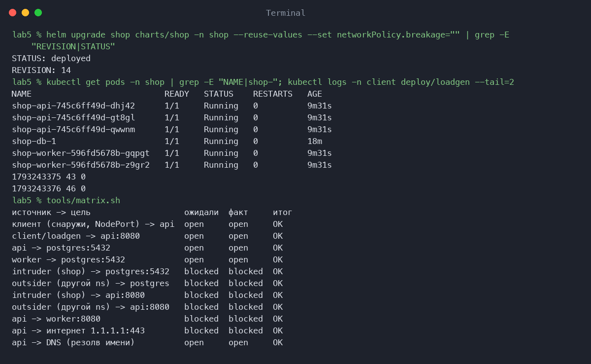
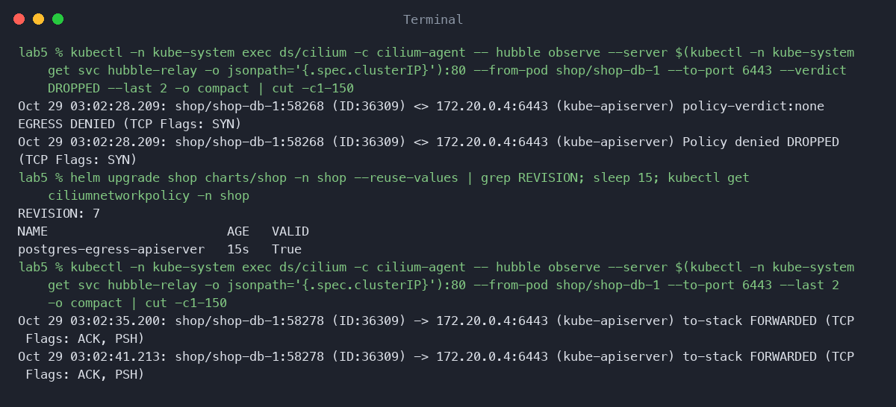
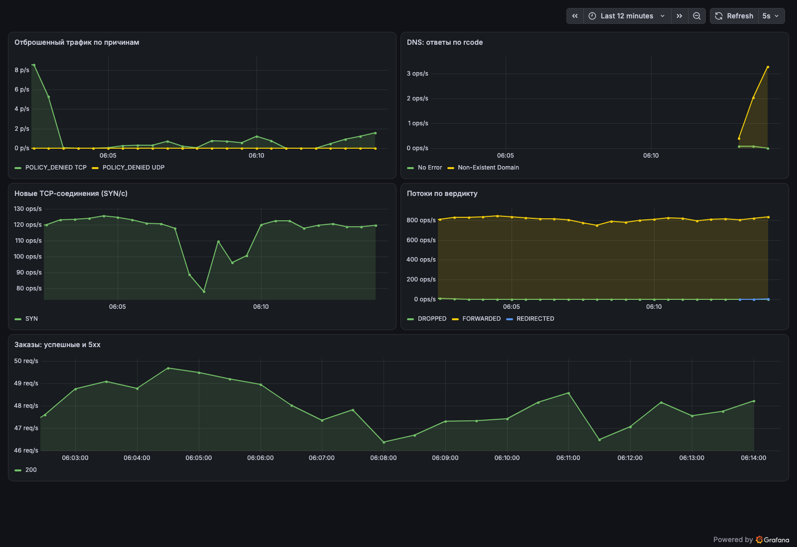
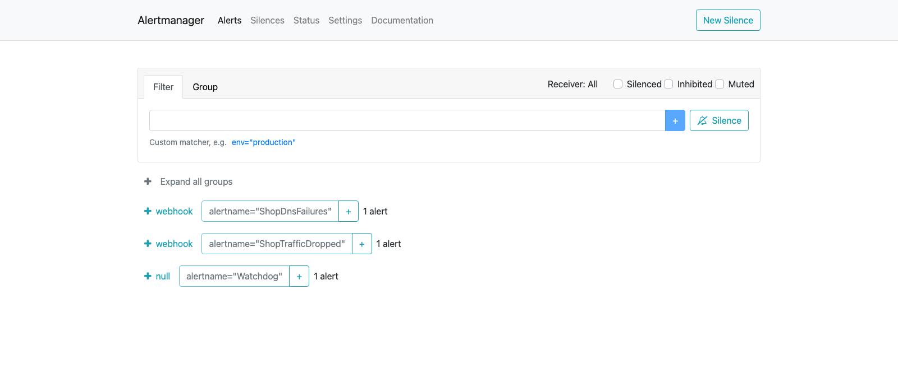

# Лаба 5 — Zero-trust сеть с доказательством

Пятая лаба про сеть. Сначала доказываю, что Service держит shop на плаву, даже когда поды под ним без остановки умирают. Потом закрываю сеть по гладиаторскому принципу «запрещено все, открыто только нужное», проверяю это матрицей, а в конце ищу скрытую поломку, глядя на карту трафика. Все через чарт shop из лабы 3, сетевые политики и мониторинг тоже его шаблоны. Мониторинг тот же kube-prometheus-stack.

## Часть 0 — Выбор CNI
Взял Cilium. Он применяет сетевые политики (у бесхребетного дефолтного kindnet правила принимаются, но молча не работают) и дает Hubble, карту трафика с причиной каждого отброшенного пакета. Calico это почтенный старожил и надежнее в классическом смысле, но наблюдаемость у него скромнее.

Кластер kind на три ноды (control-plane и два воркера), в конфиге стоит disableDefaultCNI. Тут же выяснилось, что без CNI кластер это бездыханное тело: все ноды NotReady, coredns висит в Pending, не запускается даже kube-system. CNI это не опция, а обязательная часть. Kube-proxy оставил штатный, Cilium работает рядом с ним.

## Часть 1 — Сеть пода
Заглянул под капот. У пода eth0 с маской /32, моста нет, маршрутизация идет через хост. Парный конец veth лежит на ноде, и индексы указывают друг на друга: в поде eth0@if32, а на ноде 32: lxc...@if31. Поды на разных нодах видят друг друга прямо по IP, трафик ходит через vxlan-туннель Cilium. Забавная деталь: Cilium раздает адреса из собственного пула (10.0.x.x), а осиротевший podCIDR, который kubeadm прописал нодам (10.244.x.0/24), так и висит в spec, никому не нужный.

## Часть 2 — Хаос подов
Api вынес наружу через NodePort 30080. Отличия такие. NodePort открывает порт на каждой ноде. LoadBalancer строится поверх него и просит у облака внешний балансировщик, в kind его нет. Headless-сервис (clusterIP None) вообще не балансирует, а отдает через DNS адреса самих подов, он нужен для StatefulSet и баз.

Скрипт tools/chaos.sh каждые три секунды убивает случайный под api или worker. Параллельно отдельный loadgen в неймспейсе client без остановки шлет POST /order на имя shop-api.shop.svc.cluster.local, то есть через DNS, а не по IP пода. Прогон по 90 секунд, за это время убито 29 подов. Что делает chaos.sh распишу просто по шагам потому что уже не могу нормально интегрировать это в текст поэтому буду просто отвечать на конкретный вопрос. Он берет список подов api и worker в неймспейсе shop (кроме тестовых с меткой test=true), перемешивает его и берет первый. Пишет в вывод время и имя пода, чтобы потом сопоставить с провалами. Удаляет под с флагом --wait=false, то есть не ждет, пока он завершится. Спит три секунды и повторяет, пока не истечет заданное время.

Первый результат вышел обидный. Потеряно 27 запросов из 4729, то есть 0.57 процента. Я думал, что Service тут работает идеально. Оказалось, что бодрый Go-сервер умирает по SIGTERM мгновенно, а эндпоинт упрямо, будто он Фуфелшмерц с очередным инатором, еще около секунды числится живым, и на него успевают прийти запросы. Лечится preStop: добавил в чарт lifecycle.preStop.sleep на 5 секунд. В кубернетесе 1.30+ есть встроенное действие sleep, отдельный бинарник не нужен (а в scratch его все равно нет). Повторил: 0 потерянных из 5597.

Почему вообще все работает? Хотелось бы знать :) Ну ладно, service дает стабильный IP и DNS-имя, которое резолвит CoreDNS. EndpointSlice хранит актуальный список готовых подов, и под, получивший SIGTERM, сразу выпадает из него. Kube-proxy превращает этот список в правила на каждой ноде. Режим у меня iptables (смотрел в ConfigMap): правила идут последовательной цепочкой, поэтому на тысячах сервисов IPVS с хеш-таблицей быстрее. На нашем масштабе разницы не видно.

## Часть 3 — Матрица доступа
До запрета спроектировал матрицу в табличке: кто к кому должен ходить и кто не должен.

| откуда | куда | должно быть |
|---|---|---|
| клиент снаружи (NodePort) | api:8080 | можно |
| loadgen из неймспейса client | api:8080 | можно |
| api | postgres:5432 | можно |
| worker | postgres:5432 | можно |
| api, worker | DNS (kube-dns:53) | можно |
| посторонний под (в shop и в другом неймспейсе) | postgres, api | нельзя |
| api | worker, интернет | нельзя |

Для проверки сделал отдельные тестовые поды в tools/matrix-pods.yaml: as-api и as-worker (метки как у настоящих, чтобы они получили те же политики), intruder в shop и outsider в чужом неймспейсе. Поды тут голые и беззащитные, без контроллера: умер, никто не вернет. До политик сеть плоская, все открыто, и шесть строк красные.

## Часть 4 — Включаю zero-trust
Шаблон templates/networkpolicy.yaml. Сначала default-deny на входящий и исходящий трафик, потом точечные разрешения по меткам и портам из values.yaml, отдельно DNS и необходимый egress.

Две вещи в обычной NetworkPolicy сделать не получилось, пришлось писать CiliumNetworkPolicy. Дело в том, что ipBlock в Cilium не матчится на внутрикластерные сущности. Поэтому клиента снаружи (он приходит с адресов world, host, remote-node) и доступ Postgres к kube-apiserver открыть через обычную политику нельзя, нужны fromEntities и toEntities. DNS-правило тоже сделал через CiliumNetworkPolicy: с L7-правилом для dns Cilium начинает отдавать метрики по DNS, они пригодятся для алертов.

## Часть 5 — Матрица на практике
tools/matrix.sh проходит по каждой паре и сравнивает «ожидали и получили». Тут я набил шишки. Сначала использовал nc -z, и он нагло врал: на NodePort он стучался в порт docker-прокси kind, а не в сам сервис, и давал ложный результат. Еще скрипт случайно удалял тестовые поды вместе с остальными, потому что его удаляющая команда ловила их по тому же селектору. Исправил: добавил тестовым подам метку test=true и проверку, что под существует. С NodePort с мака вообще вышел курьезный казус: с Cilium порты kind с мака (localhost:30xxx) не отвечают, поэтому строку про клиента снаружи проверяю из docker-контейнера в сети kind (curl на lab-worker:30080).

В итоге все строки зеленые: разрешенное работает, запрещенное не проходит. Посторонний под больше не может подключиться к Postgres, а api и worker могут.

## Часть 6 — Скрытая поломка
Подготовил четыре варианта поломки: dns, worker-label, api-port и no-client-ingress. Скрипт tools/break.sh случайно выбирает один, применяет через values.yaml и пересоздает поды, не говоря, какой выбрал. Пересоздание нужно, иначе rolling update просто зависнет на новых подах, а старые продолжат работать, и симптома не будет.

Симптом: api не становится Ready, а loadgen видит ноль успешных запросов в секунду. Дальше диагностика, а не гадание. Запустил hubble observe с флагом --verdict DROPPED. Тут свой подвох: через агента Cilium на одной ноде виден трафик только этой ноды, поэтому нужно ходить через hubble-relay. Среди отброшенных потоков главный: UDP от подов shop к coredns:53 с вердиктом EGRESS DENIED. То есть сломан DNS-egress, из чарта пропала политика allow-dns. Так выглядел вариант dns. Исправил значение breakage в values и подтвердил по матрице, что все снова зеленое.

Бонус. Тот же Hubble показал отброшенный поток shop-db-1 к kube-apiserver на порт 6443. Postgres тихо, как партизан, терял доступ к API из-за ipBlock, а кластер оставался healthy, и без карты трафика я бы этого не заметил. Исправил CiliumNetworkPolicy с toEntities kube-apiserver.

## Часть 7 — Мониторинг
В чарте ServiceMonitor на hubble-metrics, PrometheusRule и дашборд: отброшенный трафик, DNS по кодам ответа, SYN, потоки по вердиктам и заказы.

Три алерта:

- ShopTrafficDropped. Растет hubble_drop_total с причиной POLICY_DENIED. Политика режет трафик: либо кто-то сканирует сеть, либо сломались правила.
- ShopDnsFailures. Ответы DNS не No Error. Без DNS сервисы не находят друг друга, а еще алерт ловит NXDOMAIN от опечаток в именах.
- ShopOrdersFailing. /order отвечает 5xx. Это бизнес-симптом: клиенты не могут оформить заказ.

Спровоцировал с intruder: перебирал соединения к Postgres и запрашивал несуществующие имена. Сработали первые два алерта. ShopOrdersFailing не провоцировал.

## Результат
Вот как-то так. Слов нет - одни эмоции. Кубер это супер круто, мне очень нравится, но несмотря на проделанные лабы еще чувствую пробелы, а хочется разобраться подробнее. Дальше уже не пойду - нет ни сил за эти дни, ни времени, скажу только большой респект за курс, я шел в итмо именно за такими знаниями и такими интересными лекциями, и рад что попал сюда. Всем пис!